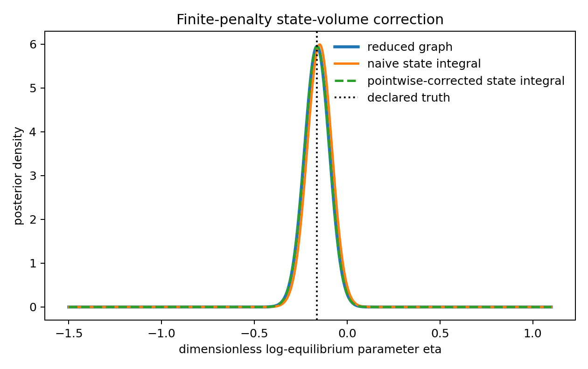
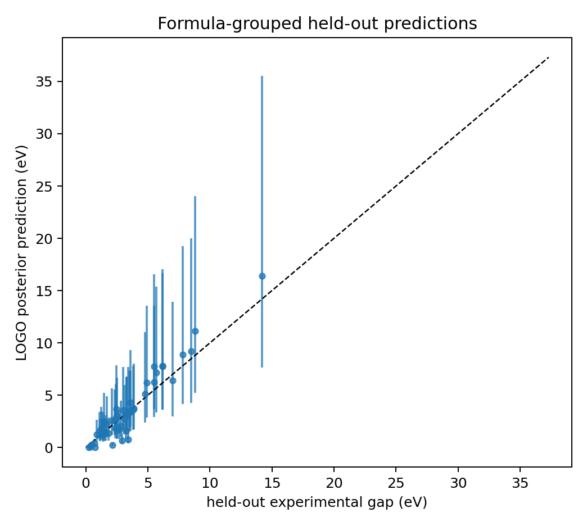

# detcorr examples: recover the probability target you intended

When a model equation is enforced with a narrow numerical penalty, some
parameter values can look more probable simply because more latent-state volume
surrounds them. `detcorr` calculates the geometric terms that remove this
unintended preference. The examples here verify that correction independently,
then show what can be learned once the requested probability measure has been
restored.

This repository contains ten runnable tutorials and three scientific case
studies built from publicly sourced data. The correction is exactly zero in a
control, measurable in several models, and strongly accumulated in a deliberate
high-dimensional stress test.

[Start in five minutes](#start-in-five-minutes) |
[Choose an example](#choose-your-route) |
[Case studies](#case-studies) |
[Verify the results](#verify-the-results) |
[Data rights](THIRD_PARTY_NOTICES.md)

## What the repository establishes

- Across the tutorials, the absolute standardized shift caused by omitting
  state volume ranges from `0.000` to `19.737` graph-posterior standard
  deviations. This
  deliberately spans a zero-effect control, moderate corrections, and a
  high-dimensional accumulation test.
- For 54 positive JARVIS band-gap pairs, a common scale improves
  formula-held-out prediction across four protocol-locked retrospective nested
  gap-threshold subsets; a separate affine diagnostic scores better and
  indicates additional systematic structure.
- For 36 JARVIS bulk-modulus pairs, the estimated common scale is close to one
  and point errors improve modestly; formula-held-out prediction leaves the
  incremental advantage over identity unresolved. For Fulton
  prices, the determinant effect is large and quantified, while the evidence
  for a non-unit scale depends on the temporal model.

These are scoped results, not universal correction factors. Their value is
that target geometry, predictive performance, and model adequacy are evaluated
separately and can therefore be interpreted cleanly.

## The design rules

1. **Declare the target measure.** State the intended graph or manifold measure
   before evaluating the result.
2. **Compute the induced state volume.** A narrow residual tube can converge on
   the constraint while retaining parameter-dependent volume.
3. **Validate through another route.** Use exact state integration,
   deterministic quadrature, or an independent matrix calculation to recover
   the declared target.
4. **Evaluate the scientific model.** Once the target geometry is correct,
   held-out prediction, adequacy checks, and sensitivity analysis show what the
   data and model support.

Here a **graph target** means the probability density obtained after solving
the constraint for its state. It is unrelated to graph neural networks.

## Start in five minutes

The examples support the public `detcorr` 0.10 API. Install the validated
public source in a fresh environment, then run the Langmuir tutorial into a
disposable output directory:

```bash
python -m venv .venv
. .venv/bin/activate
python -m pip install \
  "detcorr @ git+https://github.com/Olsson-Materials-Modelling/detcorr.git@a414f063515359f70952e2717a506b75e69e4b0b"
python -m pip install -r requirements.txt
python examples/adsorption_langmuir_equilibrium/src/adsorption_langmuir_equilibrium_demo.py \
  --outputs /tmp/detcorr-langmuir
```

The package source is
[Olsson-Materials-Modelling/detcorr](https://github.com/Olsson-Materials-Modelling/detcorr).
The commit above is the version exercised by this release. If the two
repositories are cloned side by side, `python -m pip install ../detcorr` is the
equivalent local-development route; the version gate accepts the 0.10 series.
The run writes a strict JSON summary, CSV tables, and PNG figures without
changing the committed reference outputs.

## Choose your route

- **Learn the core idea:** start with the
  [Langmuir equilibrium tutorial](examples/adsorption_langmuir_equilibrium/README.md),
  then compare it with the
  [zero-correction calorimetry
  control](examples/calorimetry_constant_determinant_control/README.md).
- **Work with materials data:** begin with the
  [JARVIS positive-gap case study](case_studies/studies/jarvis_band_gaps/README.md)
  for a supported scale signal, or the
  [JARVIS bulk-modulus case study](case_studies/studies/jarvis_bulk_modulus/README.md)
  for a near-unity scale with unresolved incremental predictive value.
- **Work with economic time series:** use the
  [Fulton case study](case_studies/studies/fulton_market/README.md) to see a
  quantified determinant effect and why temporal dependence matters.
- **Exercise numerical machinery:** use the
  [partial differential equation (PDE)
  tutorial](examples/elliptic_pde_1d/README.md) for a structured operator or
  the [screened-lattice tutorial](examples/materials_screened_lattice_2d3d_jarvis/README.md)
  for a high-dimensional sparse determinant.
- **Browse all tutorials:** see the concise [examples index](examples/README.md).

## How the correction enters

For an implicit relation `c(theta,u)=0`, integrating a narrow residual tube over
the state `u` introduces a volume that can depend on `theta`. To recover a
density declared on the solved graph, the corrected finite-penalty target
contains

```math
\log(J/q) + \tfrac12\log\det R - \tfrac{\rho}{2}c^T R c.
```

Here `J` is the state-Jacobian volume, `q` is the declared state-base density,
and `R` is the residual metric. `detcorr` supplies the Jacobian and metric
terms; the modeller declares and consistently accounts for `q`. The complete
coordinate and measure contract is in
[TECHNICAL_DETAILS.md](TECHNICAL_DETAILS.md).

## Correction spectrum across the tutorials

The common comparison is

```text
(naive posterior mean - corrected posterior mean) / graph posterior SD.
```

Its sign gives the direction of the shift. Its magnitude measures the effect
within that fixed demonstrator; it is not a ranking of scientific importance.

| Worked example | Main correction driver | Omission effect |
|---|---|---:|
| [Constant-determinant calorimetry](examples/calorimetry_constant_determinant_control/README.md) | `D_u c=1` control | `0.000` SD |
| [Implicit decay time stepping](examples/kinetics_decay_time_stepping/README.md) | Triangular time-step Jacobian | `-0.102` SD |
| [Langmuir equilibrium](examples/adsorption_langmuir_equilibrium/README.md) | Nonlinear bounded-state Jacobian | `+0.210` SD |
| [JARVIS bulk-modulus scale](examples/materials_bulk_modulus_samplers_jarvis/README.md) | Repeated scale Jacobian | `+0.400` SD |
| [Weighted sensor constraint](examples/sensor_weighted_constraint/README.md) | Parameter-dependent residual metric | `-0.547` SD |
| [JARVIS positive-gap scale](examples/materials_bandgap_samplers_jarvis/README.md) | Positive-state log residual | `+0.762` SD |
| [Elliptic PDE](examples/elliptic_pde_1d/README.md) | Discrete-operator determinant | `-0.832` SD |
| [Held-out Fulton price scale](examples/econometrics_fulton_market/README.md) | Repeated latent-price Jacobian | `-1.809` SD |
| [Held-out Matbench gap test](examples/materials_bandgap_matbench/README.md) | Nonlinear powered coordinate | `-1.923` SD |
| [Screened lattice](examples/materials_screened_lattice_2d3d_jarvis/README.md) | High-dimensional sparse determinant | `-19.737` SD |



*The corrected state integral follows the blue solved-graph target, while the
uncorrected tube is visibly shifted by nonlinear state volume.*

Every nonconstant tutorial has a load-bearing independent state-integration,
quadrature, or determinant check. The screened lattice is a numerical stress
test; domain interpretation belongs to the scientific case-study tier.

## Case studies

The standalone, self-verifying [case-study tier](case_studies/README.md) adds
grouped or temporal prediction, adequacy checks, sensitivity analysis,
influence diagnostics, and falsification controls. `Delta ELPD` is the change
in summed held-out log predictive density relative to identity; positive values
favour calibration.

### JARVIS bulk modulus: near-unity scale; incremental value unresolved

On the pinned 36-row fixture, the estimated common OPT scale is close to one.
The common-scale model modestly lowers point errors, but its formula-held-out
`Delta ELPD=-0.647` has a 90% interval spanning both directions. A separate
fixed-likelihood Gaussian geometry audit--not the Student-`t` predictive
primary--recovers the same target through equivalent coordinate routes. The
measure calculation is supported; neither predictive improvement nor
equivalence to identity is established by this comparison.

A separate non-primary direct-GPa Gaussian diagnostic modestly favours scale on
point scores but permits nonphysical negative-modulus tails, making the primary
comparison explicitly model-specific.

The next step is a provenance-resolved matched dataset with method, phase,
temperature, uncertainty, and physically motivated discrepancy classes.

### JARVIS positive gaps: scale helps, and structure remains

A common scale improves grouped prediction across four protocol-locked
retrospective nested positive-gap threshold subsets (`Delta ELPD=+28.654`),
while a separate unbounded affine Gaussian diagnostic scores better still and
indicates richer structure. The grouped signal, nested-subset sensitivity, and
geometry checks are supported; overall model adequacy remains mixed. The
threshold comparison is a within-fixture nested-subset analysis, not
independent-domain replication.

The next step is to add measurement type, uncertainty, zero/metallic/censored
cases, physical material classes, and genuinely external group tests.

### Fulton prices: the determinant effect is quantified

Omitting the declared state-volume factor shifts the rolling log scale by mean
`-2.744` corrected-posterior SD. Whether the evidence establishes improved
held-out conditional prediction from a non-unit calibration depends on the
temporal model. The volume effect and dependence sensitivity are supported;
improvement over identity under the primary temporal model is not.

The next step is to add structural variables, credible instruments where causal
interpretation is intended, richer temporal drivers, and new out-of-period
observations.



*Points are formula-held-out posterior medians, vertical bars are 90% predictive
intervals, and the dashed diagonal is exact agreement with experiment.*

Across all three studies, `detcorr` preserves the declared latent-state measure
so added physical or economic structure is judged without a coordinate-volume
confounder.

## Verify the results

Use these routes for different purposes:

- `make verify` regenerates all ten tutorials in a temporary location and
  compares the tutorial result surface within declared tolerances.
- `make verify-release` additionally requires exact generated artifact bytes in
  the pinned reproduction environment.
- `make -C case_studies verify-reference` validates the committed full
  scientific payload without recomputing it.
- `make -C case_studies test` runs the scientific tests; the reference run took
  about **11 minutes on one CPU**.
- `make -C case_studies full` recomputes all three full studies; the reference
  run took about **30 minutes on one CPU**.
- `make -C case_studies verify` runs the full recomputation and test suite,
  validates both result manifests, and requires every fresh scientific artifact
  to match the committed reference; budget for both stages plus verification
  overhead.

The full runner processes the studies sequentially and can remain inside JARVIS
resampling for several minutes with little console output. Completion messages
appear after each study. Times vary with hardware and numerical libraries.
Exact dependencies, artifact-versus-semantic verification, workflow dispatch,
and output retrieval are described in
[TECHNICAL_DETAILS.md](TECHNICAL_DETAILS.md).

## Documentation and reuse

At the repository, case-study, and project levels:

- `README.md` gives the premise, result, significance, and fastest run route.
- `TECHNICAL_DETAILS.md` records the mathematical, numerical, provenance,
  validation, and reproduction contract.

Generated JSON and CSV remain authoritative for exact values. The repository
supports the fixture-conditional findings above and reusable validation
patterns; broader prediction, transfer, physical mechanism, or causal
interpretation requires the additional domain evidence stated by each study.

## Citation, licence, and data rights

Use [CITATION.cff](CITATION.cff) to cite this repository release and retain the
source-specific citations for any bundled data you reuse. Repository-authored
code and documentation are covered by [LICENSE](LICENSE). Third-party fixtures
retain their own terms; consult
[THIRD_PARTY_NOTICES.md](THIRD_PARTY_NOTICES.md) before redistribution.
