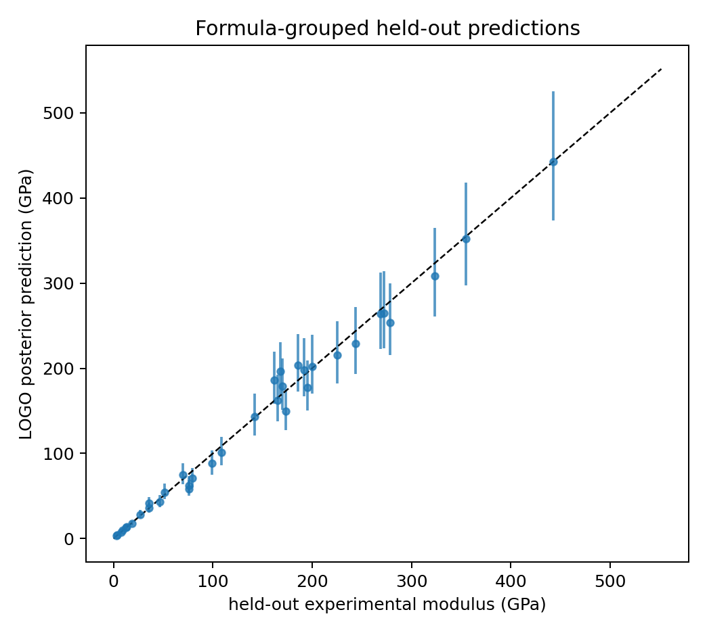
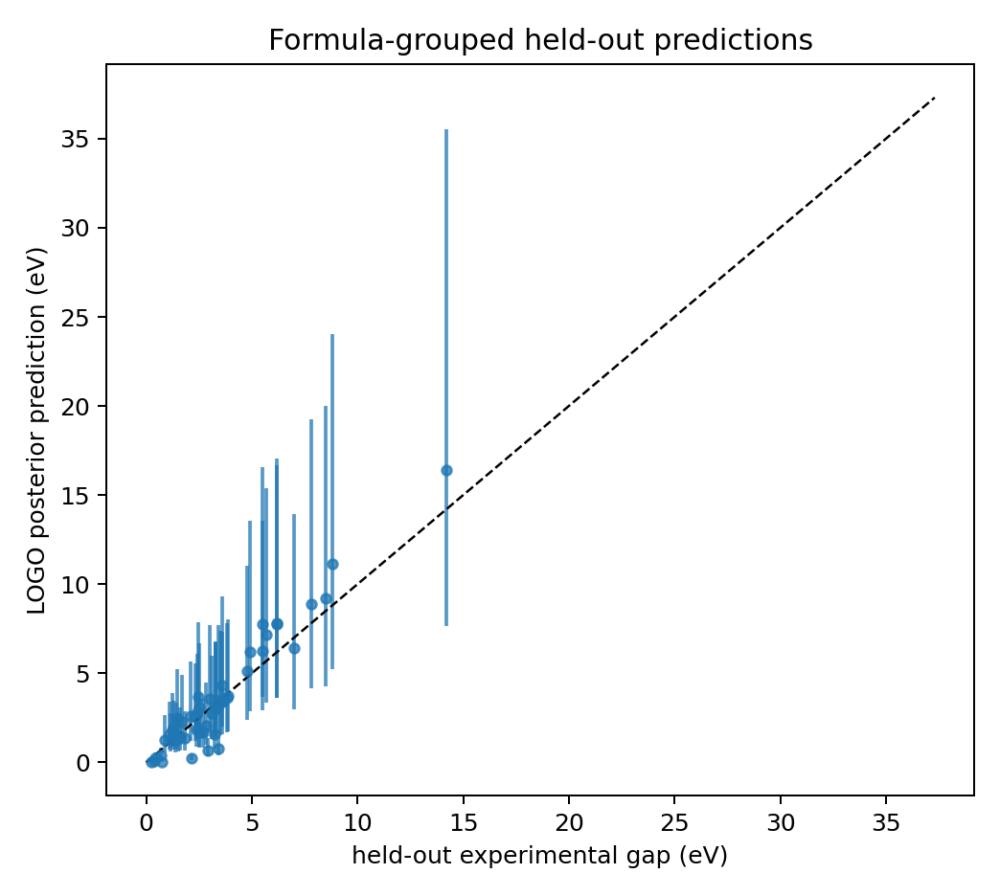
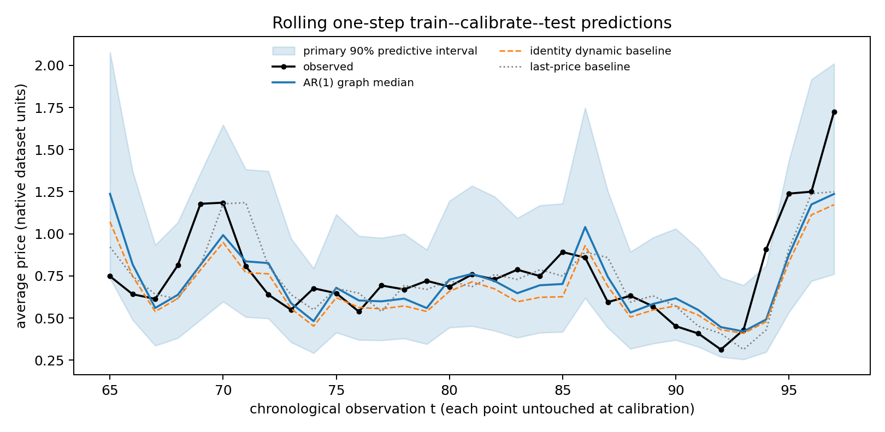
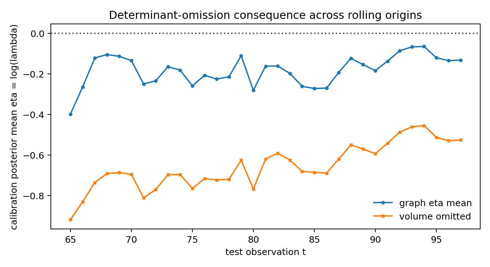

# detcorr scientific case studies

[Results](#results-at-a-glance) ·
[Build on the studies](#building-on-the-results) ·
[Run and verify](#run-and-verify) ·
[Technical details](TECHNICAL_DETAILS.md) ·
[Data rights](THIRD_PARTY_NOTICES.md)

These studies show what becomes scientifically interpretable once constrained
inference uses the intended probability measure. `detcorr` removes the
state-volume preference induced by a finite constraint tube; held-out
prediction, adequacy checks, and sensitivity analysis then identify the domain
signal supported by the data.

Here **graph target** means the probability density obtained after solving the
constraint for its state. It is unrelated to graph neural networks. Across
three checksum-pinned public-source fixtures, the workflow finds a stable
grouped scale signal across nested positive-gap subsets, a near-unity
bulk-modulus scale with unresolved incremental predictive value, and a
quantitatively important state-volume effect for
Fulton prices whose scale interpretation depends on temporal modelling.

## Results at a glance

`Delta ELPD` is the change in summed held-out log predictive density relative
to identity; positive values favour calibration and negative values favour
identity. Formula-LOGO means leave-one-formula-group-out: every polymorph of a
chemical formula stays on the same side of a fold.

### JARVIS bulk modulus: near-unity scale; incremental value unresolved

The 36 paired optB88-vdW (`OPT`) and experimental values are strongly
associated, and the estimated common scale is close to one. The common-scale
model modestly lowers point errors, but the formula-held-out comparison gives
`Delta ELPD=-0.647` with 90% formula-bootstrap interval
`[-2.0679, 0.7848]`. A separate fixed-likelihood Gaussian geometry audit—not
the Student-`t` predictive primary—recovers the same target through equivalent
coordinate routes, so the absence of a resolved scale advantage is not a
coordinate-volume artifact.

The measure calculation is supported; neither a predictive advantage for scale
nor equivalence to identity is established.

A separate non-primary direct-GPa Gaussian diagnostic modestly favours scale
on point scores but permits nonphysical negative-modulus tails, underscoring
that the primary comparison is model-specific.



*Points are formula-held-out posterior medians, vertical bars are 90% predictive
intervals, and the dashed diagonal is exact agreement with experiment.*

### JARVIS positive gaps: a scale signal with additional structure

For 54 positive-gap pairs, a common scale improves formula-held-out prediction
across all four protocol-locked retrospective nested gap-threshold subsets.
`Delta ELPD=+28.654`, with 90% formula-bootstrap interval
`[18.591, 37.782]`. A separate unbounded affine Gaussian diagnostic scores
better still, indicating structure beyond a common multiplier.

The grouped signal, nested-subset sensitivity, and geometry checks are
supported; overall model adequacy remains mixed because the affine model adds
value. The threshold comparison is within-fixture sensitivity analysis, not
independent-domain replication.



*The common-scale model moves the grouped predictions toward experiment; the
vertical bars show its 90% posterior predictive intervals.*

### Fulton prices: a quantified state-volume effect

Thirty-three rolling one-step evaluations show that the determinant factor
materially changes calibration. Omitting it shifts the rolling log scale
`eta=log(lambda)` by mean `-2.744` corrected-posterior SD. Point estimates
favour the corrected target by `3.416` cumulative log-score units and `0.02094`
mean continuous ranked probability score (`CRPS`), although the moving-block
interval for the mean log-score difference crosses zero. Whether the evidence
establishes improved conditional prediction from a non-unit scale depends on
the temporal model.

The volume effect and dependence sensitivity are supported; improvement over
identity under the primary temporal model is not.



*Each black point is an observation unavailable during calibration; the blue
line and band give the primary first-order autoregressive prediction and its
90% interval.*



*At every rolling origin, omitting state volume moves the inferred log scale
away from the corrected target.*

Together the results demonstrate a reusable workflow: correct target geometry,
evaluate held-out formulas or times, and use adequacy and sensitivity analyses
to identify the next scientific model improvement.

## Building on the results

### For bulk-modulus research

The current foundation is a geometry-verified near-unity common scale with
unresolved incremental predictive value on the pinned 36-row fixture. A
high-value extension would add source-level uncertainty,
phase, temperature, and protocol metadata, then compare physically motivated
discrepancy classes on new formula groups. `detcorr` keeps coordinate volume
from confounding that comparison.

### For band-gap research

The current foundation is a grouped scale signal across four retrospective
nested positive-gap threshold subsets, together with evidence for richer-than-scale structure. A high-value
extension would add fundamental/optical classification, uncertainty,
zero/metal/censored cases, source deduplication, richer models, and prospective
validation. `detcorr` preserves the declared positive-state target while those
models are compared.

### For economic research

The current foundation is a quantified state-volume consequence and a clear
diagnosis of dependence sensitivity. A high-value extension would add
structural variables, credible instruments where causal interpretation is
intended, fuller dependence uncertainty, and genuinely future observations.
`detcorr` recovers the requested latent-price target before identification and
mechanism are assessed.

## Run and verify

Use a separate environment for this standalone, self-verifying source tree:

```bash
cd case_studies
python -m venv .venv
. .venv/bin/activate
python -m pip install \
  "detcorr @ git+https://github.com/Olsson-Materials-Modelling/detcorr.git@a414f063515359f70952e2717a506b75e69e4b0b"
python -m pip install -c constraints-publisher.txt -e '.[test]'
```

The `detcorr` source is
[Olsson-Materials-Modelling/detcorr](https://github.com/Olsson-Materials-Modelling/detcorr).
The commit above is the version exercised by the reference payload. With
adjacent checkouts, install the sibling source using
`python -m pip install ../detcorr` for development, tests, and quick
verification. Claim-bearing full recomputation requires the pinned Git command
above so the exact public commit is recorded in `run_manifest.json`.

Choose the verification route that matches your goal:

```bash
make verify-reference  # verify the committed full result surface
make verify-quick      # fresh CI-sized implementation run plus tests
make test              # scientific unit and contract tests
make verify            # full run, tests, and exact scientific-result reproduction
```

On the reference one-CPU environment, `make test` took about **11 minutes** and
`make full` took about **30 minutes**. `make verify` performs both stages before
validating the committed and fresh manifests and comparing their complete
scientific artifact surfaces. The full runner works sequentially through bulk
modulus, positive gaps, and Fulton; JARVIS resampling can remain quiet for
several minutes before a completion message appears. Hardware and numerical
libraries will change these times.

The manual `.github/workflows/full-analysis.yml` workflow runs the same full
analysis on GitHub Actions and retains its environment report and result tree as
an artifact. See [technical details](TECHNICAL_DETAILS.md) for dispatch,
custom-data contracts, environment capture, and the exact output contract.

## Scope, citation, and rights

These retrospective analyses support the fixture-conditional findings above.
Transfer to new materials, prospective prediction, and structural economic
interpretation follows the constructive extensions stated here. Generated JSON
and CSV files remain authoritative for exact values and evidence identifiers.

When citing a study, cite the repository release and retain the source-specific
citation for its fixture. Third-party fixture rights and attribution are
recorded in [THIRD_PARTY_NOTICES.md](THIRD_PARTY_NOTICES.md); the scoped
[LICENSE](LICENSE) covers original case-study code and documentation.
