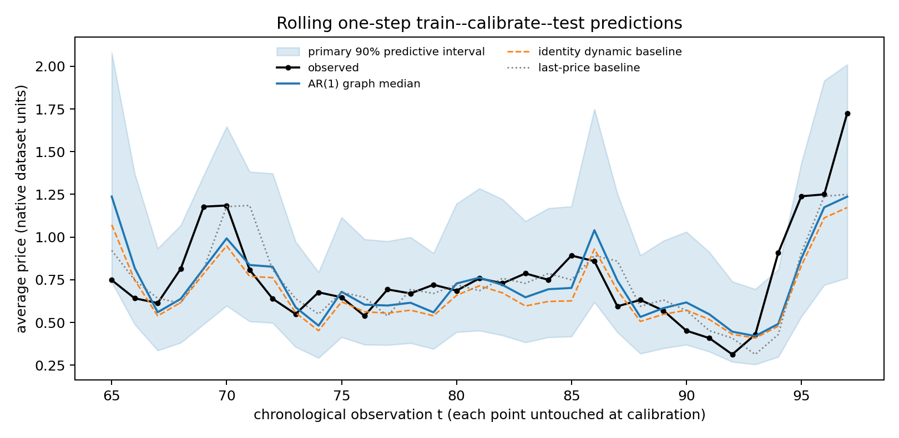
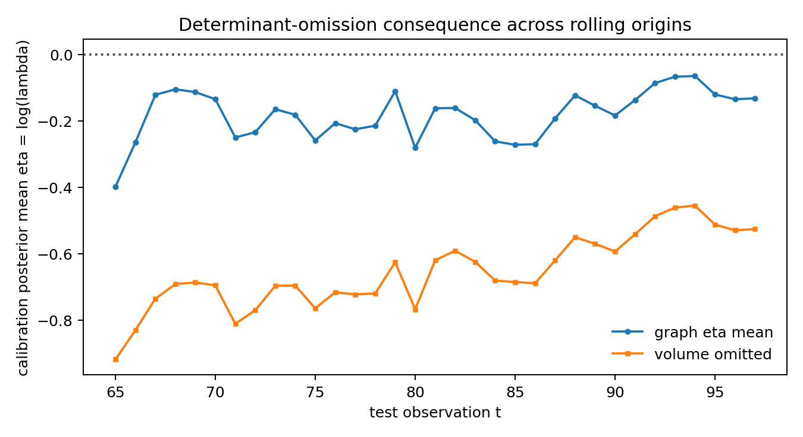

# Fulton prices: a quantified state-volume effect and dependence-sensitive calibration

[Case-study overview](../../README.md) ·
[Technical details](TECHNICAL_DETAILS.md) ·
[Run](#run)

This study quantifies how much determinant correction changes a price-scale
calibration, then tests whether the corrected scale improves prediction for
prices unavailable to the fit.

The multiplicative calibration is `lambda` and its log is
`eta=log(lambda)`. The **graph target** is the posterior obtained after solving
the latent-price constraint; it is unrelated to a network graph. The factor
`J/q` is the state-Jacobian volume divided by the declared state-base density.

Data source: K. Graddy, “Testing for Imperfect Competition at the Fulton Fish
Market,” *RAND Journal of Economics* **26** (1995), 75–92, via the
[`wooldridge::fish` data package](https://CRAN.R-project.org/package=wooldridge)
and Rdatasets. Attribution and reuse terms are in the
[case-study data notices](../../THIRD_PARTY_NOTICES.md).

## Take-home result

The state-volume factor has a clear quantitative impact: omitting `J/q` shifts
rolling `eta` by mean `-2.744` graph-posterior SD. Predictive-score point
estimates favour the corrected target, but their moving-block log-score
interval crosses zero. After correcting the target, evidence for a non-unit
scale depends strongly on the temporal discrepancy model. Within the declared
comparisons, dependence is the gate-changing modelling choice and therefore
the immediate next economic question.

The volume effect and dependence sensitivity are supported; improvement over
identity under the primary temporal model is not.

## Method

The 97-row Fulton fish-market fixture supplies 33 rolling one-step evaluations.
For test row `t`, rows before `t-16` fit a positive log-price reference, the next
16 rows calibrate `eta`, and row `t` is untouched and scored once. Test-row
weather, weekday, and trend covariates are treated as known, so these are
conditional nowcasts rather than unconditional advance forecasts.

The primary discrepancy is a plug-in first-order autoregressive model (`AR(1)`)
in log price, estimated only from each origin's reference-training residuals.
The graph calibration is compared with a matched scale-one model, independent
and identically distributed (`iid`) and
coefficient-covariance sensitivities, a lag-four falsification control, and
last-price persistence. Paired score differences use a 90% circular
moving-block interval with block length four and seed `20260711`.

## Predictive finding

The primary AR(1) graph-minus-identity cumulative log-score difference is
`+0.408` across 33 origins, but the 90% moving-block interval for the mean is
`[-0.0417, 0.0634]`. Graph continuous ranked probability score (`CRPS`) is worse
by `0.000069`, while last-price persistence has cumulative log score `0.745`
higher than the graph model. Identity therefore remains competitive under the
primary temporal model.

The matched iid calibration effect is much larger, with `Delta ELPD=+6.180`
and a positive 90% interval, whereas the primary AR(1) interval crosses zero.
Here `Delta ELPD` is the change in summed held-out log predictive density
relative to identity; positive values favour calibration. Within the evaluated
model family, temporal dependence is the main source of uncertainty in the
evidence for a non-unit calibration scale.



*Each black point is an observation unavailable during calibration; the blue
line and band give the primary AR(1) prediction and its 90% interval.*

## What detcorr changes

Relative to the declared graph target, omitting `J/q`:

- shifts rolling `eta` by mean `-2.744` graph-posterior SD;
- has cumulative log score lower by `3.416`; and
- has mean CRPS higher by `0.02094`.

The last two values are observed point-score differences. The 90% moving-block
interval for the mean graph-minus-omission log-score difference is
`[-0.029, 0.233]`, so predictive superiority is not established independently
of the geometry result.

Independent analytic and finite-tube routes recover the same target. This
establishes a quantified geometry result independently of whether calibrated
scale beats identity.



*At every rolling origin, omitting state volume moves the inferred log scale
away from the corrected target.*

The full coordinate, residual-metric, dependence-sensitivity, and numerical
audits are recorded in [TECHNICAL_DETAILS.md](TECHNICAL_DETAILS.md).

## Building on this result in economic work

1. **Current foundation.** The state-volume effect materially shifts inference,
   while the primary AR(1) analysis does not establish improvement over
   identity and identifies dependence sensitivity.
2. **High-value next step.** Add explicit structural variables and credible
   instruments where causal claims are intended, measurement and
   covariate-timing protocols, fuller dependence and nuisance uncertainty, and
   genuinely future or external validation.
3. **`detcorr` contribution.** It corrects the latent price-state geometry so
   structural and causal models can be assessed against the requested
   calibration target.

## Run

Install the case-study environment using the
[overview instructions](../../README.md#run-and-verify). Then, from
`case_studies/`:

```bash
python studies/fulton_market/run_analysis.py --quick \
  --output-root outputs/fulton-market-quick
python studies/fulton_market/run_analysis.py --full \
  --output-root outputs/fulton-market-full
```

Or use the registered runner:

```bash
python run_studies.py --full --study fulton_market \
  --output-root outputs-fulton
```

The full bundled-fixture run reproduces the reported result; the quick run
verifies the implementation workflow. The complete three-study full run took
about 30 minutes on one CPU in the reference environment, and this study is one
part of that workload. Custom-input requirements are in
[TECHNICAL_DETAILS.md](TECHNICAL_DETAILS.md).

## Where this leads

Under the rolling protocol, dependence assumptions change the evidential gate
for a non-unit scale, while determinant correction has a clear and quantified
consequence for the target and predictive distribution. The result supports a
conditional evaluation of calibration under the plug-in reference and known
contemporaneous covariates; it does not establish improvement over identity.
Structural variables, identification, and future observations provide the
route to causal or market-level interpretation.
Generated tables and `summary.json` remain authoritative for exact values.
