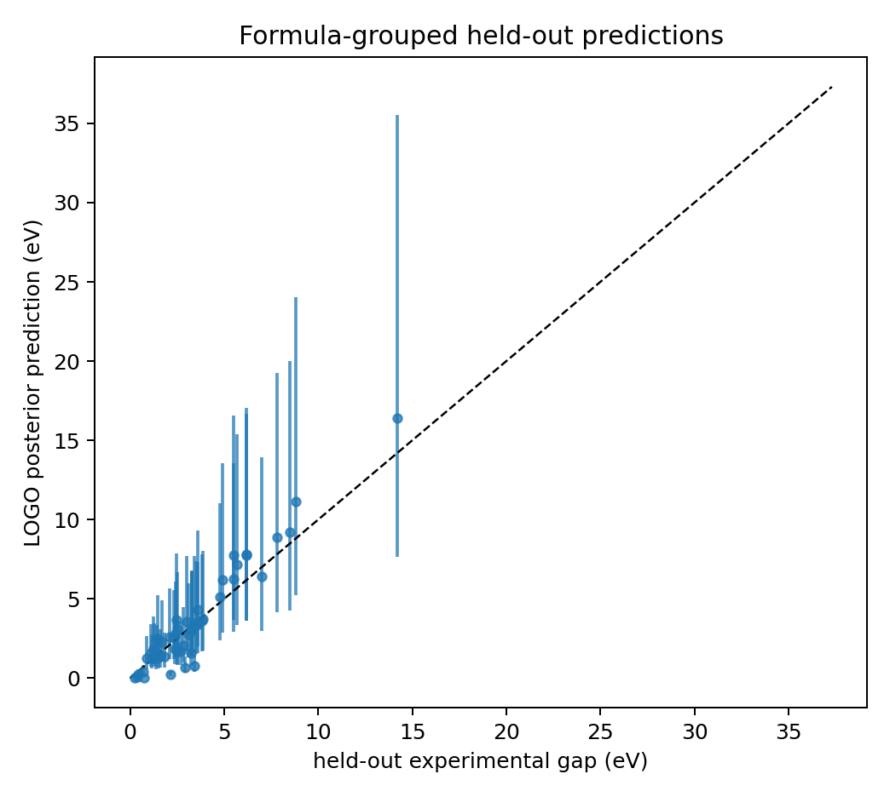
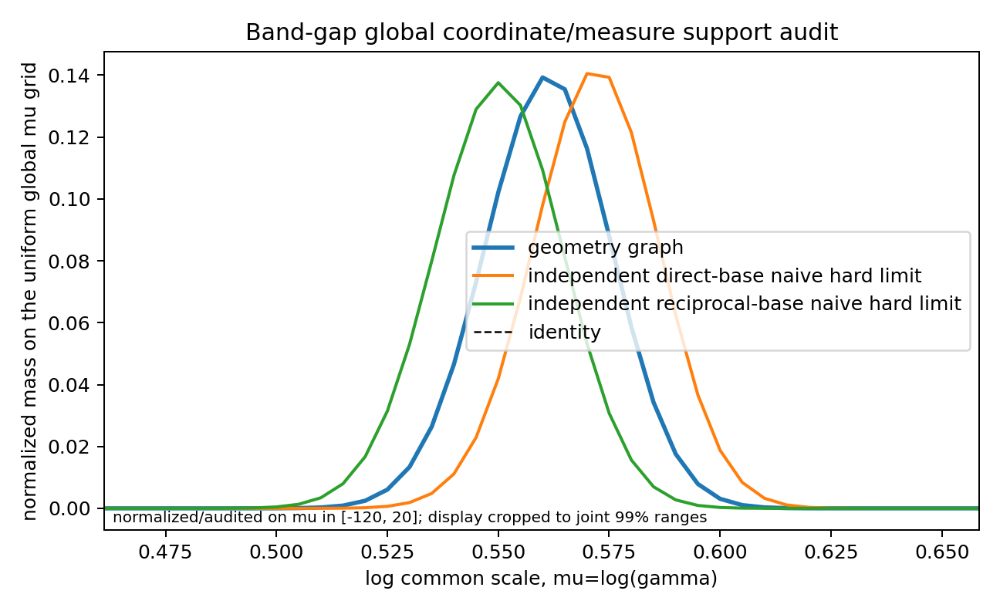

# JARVIS positive gaps: a grouped scale signal with additional structure

[Case-study overview](../../README.md) ·
[Technical details](TECHNICAL_DETAILS.md) ·
[Run](#run)

On the pinned positive-gap fixture, one multiplicative scale improves
formula-held-out prediction and the direction persists across four
protocol-locked retrospective nested calculated-gap threshold subsets. This
study evaluates that signal and tests whether an affine diagnostic captures
additional structure. A separate fixed-likelihood Gaussian geometry audit—not
the Student-`t` predictive primary—verifies the declared probability target
independently.

The calculated inputs are optB88-vdW (`OPT`) gaps. The scale is
`gamma`, and **graph target** means the posterior obtained after solving the
constraint for its positive energy state; it is unrelated to a graph neural
network. Formula-LOGO means leave-one-formula-group-out, so every polymorph of a
formula stays on the same side of a fold.

Data source: Choudhary *et al.*,
[Table 3 of *Scientific Data* 5, 180082 (2018)](https://doi.org/10.1038/sdata.2018.82),
adapted under CC BY 4.0 as recorded in the
[case-study data notices](../../THIRD_PARTY_NOTICES.md).

## Take-home result

On the pinned 54-row positive-gap fixture, a common scale substantially
improves formula-held-out prediction over identity, and that direction persists
across all four protocol-locked retrospective nested gap-threshold subsets. An
unbounded affine Gaussian diagnostic scores better, indicating systematic
structure beyond one multiplier.

The grouped signal, nested-subset sensitivity, and geometry checks are
supported; overall model adequacy remains mixed because the affine model adds
value. These nested subsets test within-fixture threshold sensitivity; they are not
independent-domain replications.

## Method

The scientific primary compares a robust Student-`t` model with four degrees of
freedom (`t4`) for the common scale in log gap ratio with the same discrepancy
model fixed at identity. Log predictive density
on the eV scale, root-mean-square error (`RMSE`), mean absolute error (`MAE`),
and 50%/90% interval behaviour are
evaluated on held-out rows. The reference run uses 2,000 formula-cluster
bootstrap draws and 2,000 pairing permutations with seed `20260711`.

The complete grouped comparison is repeated at fixed calculated-gap thresholds
`0`, `0.25`, `0.50`, and `1.00 eV`. A separate direct
identity/scale/affine screen tests whether a common multiplier adequately
describes the relationship.

## Predictive result

The common-scale posterior has mean `gamma=1.72788`, posterior SD `0.09466`,
and central 90% interval `[1.58117, 1.89124]`.

| Model | RMSE (eV) | MAE (eV) | Mean log density | 90% coverage |
|---|---:|---:|---:|---:|
| Identity | `1.618` | `1.329` | `-2.313` | `0.889` |
| Common scale | `1.013` | `0.755` | `-1.783` | `0.889` |

Aggregate formula-LOGO `Delta ELPD=+28.654` for the graph target minus
identity; its 90% formula-bootstrap interval is `[18.591, 37.782]`. Positive
values favour calibration. The affine adequacy screen improves further, with
RMSE `0.729 eV` and mean log density `-1.121`, versus `0.835 eV` and `-1.273`
for direct scale. The fixture therefore supports a scale component and also
indicates additional structure beyond it. The numerical multiplier itself is
sensitive to the discrepancy family, so it is a fixture-level calibration
summary rather than a transferable band-gap correction.



*Points are formula-held-out posterior medians, vertical bars are 90% predictive
intervals, and the dashed diagonal is exact agreement with experiment.*

## Stability across nested positive-gap thresholds

| Minimum calculated gap (eV) | Rows | Delta ELPD | 90% interval |
|---:|---:|---:|---:|
| `0.00` | 54 | `28.654` | `[18.591, 37.782]` |
| `0.25` | 48 | `35.962` | `[26.254, 44.940]` |
| `0.50` | 46 | `39.823` | `[31.600, 47.259]` |
| `1.00` | 35 | `31.985` | `[24.252, 39.402]` |

Every fixed threshold preserves the full-fixture direction and every interval
excludes zero in that direction. This supports fixture-level stability across
the declared nested threshold subsets. Metals, zero-gap systems, and genuinely
external domains form the natural next validation stage.

## What detcorr adds

A separate fixed-likelihood direct-eV Gaussian geometry audit uses independent
coordinate and finite-tube calculations to recover the same graph target. It
does not replace the Student-`t` predictive primary. This makes the common-scale
signal interpretable under the declared constrained measure rather than as an
effect of coordinate-induced state volume.



*This figure belongs to the separate Gaussian geometry audit. The blue curve is
its declared graph target; orange and green are the plotted, deliberately
uncorrected coordinate controls. Their corrected curves are not plotted, but
the machine audit verifies that both coincide with the blue target.*

Exact route definitions, tolerances, and negative controls are recorded in
[TECHNICAL_DETAILS.md](TECHNICAL_DETAILS.md).

## Building on this result in materials work

1. **Current foundation.** The pinned fixture has a grouped scale signal across
   all four fixed thresholds, while the affine diagnostic indicates that a
   richer model is worth investigating.
2. **High-value next step.** Add row-level fundamental/optical classification,
   experimental uncertainty and protocol metadata, zero-gap, metallic and
   censored cases, source-deduplicated larger data, richer models, and
   outcome-unseen validation.
3. **`detcorr` contribution.** It makes the positive-state log-residual target
   coordinate-defensible, separating grouped predictive signal from
   target-measure artifacts and remaining model structure.

## Run

Install the case-study environment using the
[overview instructions](../../README.md#run-and-verify). Then, from
`case_studies/`:

```bash
python studies/jarvis_band_gaps/run_analysis.py --quick \
  --output-root outputs/jarvis-band-gaps-quick
python studies/jarvis_band_gaps/run_analysis.py --full \
  --output-root outputs/jarvis-band-gaps-full
```

Use `--full` on the bundled fixture to reproduce the reported result;
`--quick` verifies the implementation workflow. The complete three-study full
run took about 30 minutes on one CPU in the reference environment, and this study
is one part of that workload. Custom-input requirements are in
[TECHNICAL_DETAILS.md](TECHNICAL_DETAILS.md).

## Where this leads

The result supports fixture-conditional predictive value and nested-threshold
sensitivity while identifying richer functional form and materials provenance
as the next research stage. Transfer to new datasets, metals, zero/censored
gaps, or measurement classes requires that additional evidence. Machine-readable
tables and `summary.json` remain authoritative for exact values.
