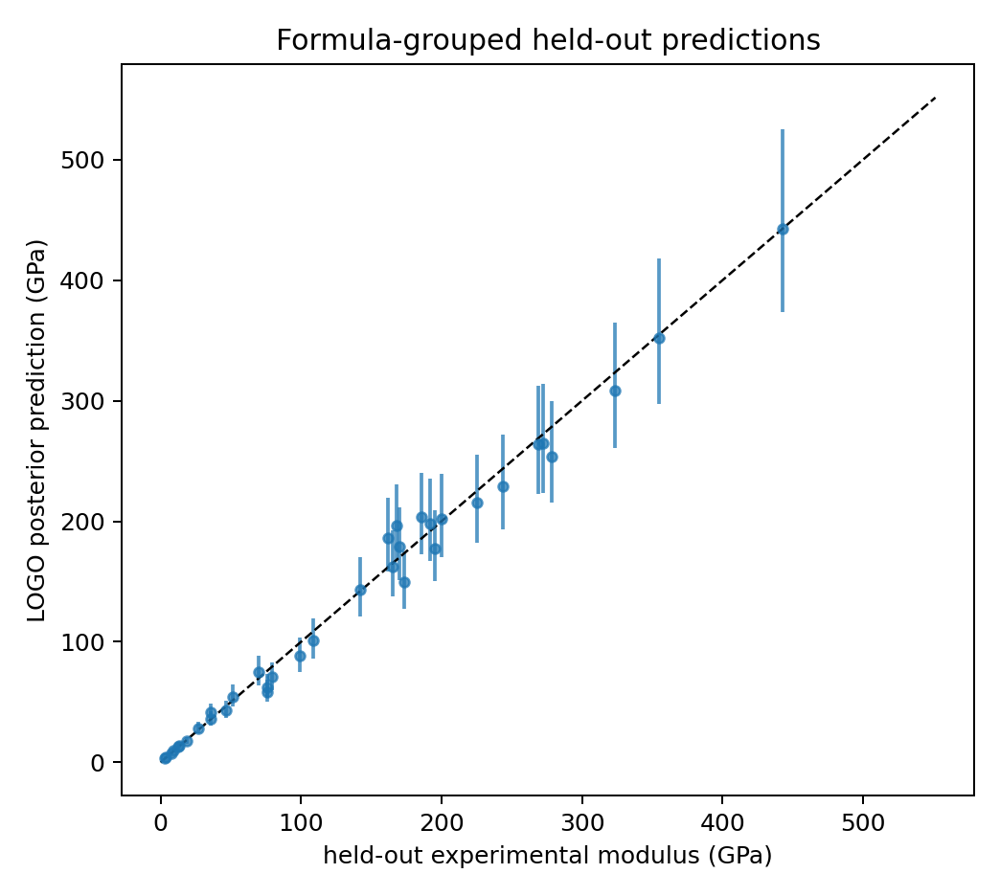
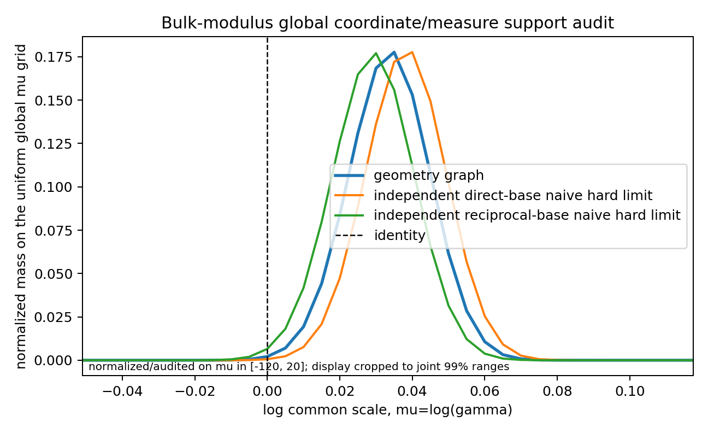

# JARVIS bulk modulus: near-unity scale; incremental predictive value unresolved

[Case-study overview](../../README.md) ·
[Technical details](TECHNICAL_DETAILS.md) ·
[Run](#run)

On the pinned bulk-modulus fixture, the estimated common scale is close to one
and point errors improve modestly, while formula-held-out prediction leaves the
incremental advantage over identity unresolved. This study evaluates that
comparison. A separate fixed-likelihood Gaussian geometry audit—not the
Student-`t` predictive primary—verifies the declared probability target across
equivalent coordinate descriptions.

The calculated inputs are optB88-vdW (`OPT`) bulk moduli. The scale is `gamma`,
and **graph target** means the posterior obtained after solving the constraint
for its positive modulus state; it is unrelated to a graph neural network.
Formula-LOGO means leave-one-formula-group-out, so every polymorph of a formula
stays on the same side of a fold.

Data source: the
[NIST JARVIS-DFT bulk-modulus comparison table](https://jarvis-materials-design.github.io/dbdocs/jarvisdft/).
Attribution and reuse terms are summarized in the
[case-study data notices](../../THIRD_PARTY_NOTICES.md).

## Take-home result

The calculated and experimental bulk moduli are strongly associated, the
estimated common scale is close to one, and point errors improve modestly. The
formula-held-out probabilistic comparison leaves the incremental predictive
advantage unresolved after the measure geometry has been independently
verified in the separate fixed-likelihood audit.

The measure calculation is supported; neither predictive improvement nor
equivalence to identity is established by this comparison.

## Method

The checksum-pinned fixture contains 36 paired calculated and experimental bulk
moduli. The scientific primary compares a robust Student-`t` model with four
degrees of freedom (`t4`) for the common scale in log bulk-modulus ratio with
the same discrepancy model fixed to one.

Predictions are compared by log predictive density on the GPa scale,
root-mean-square error (`RMSE`), mean absolute error (`MAE`), and 50%/90%
interval behaviour. The reference run
uses 2,000 formula-cluster bootstrap draws and 2,000 formula-pairing
permutations with seed `20260711`. A separate identity/scale/affine screen tests
whether the one-scale description is adequate.

## Predictive result

The common-scale posterior is close to identity: mean `gamma=1.01293`,
posterior SD `0.01537`, and central 90% interval `[0.98800, 1.03868]`.

| Model | RMSE (GPa) | MAE (GPa) | Mean log density | 90% coverage |
|---|---:|---:|---:|---:|
| Identity | `11.720` | `8.506` | `-3.399` | `0.917` |
| Common scale | `11.412` | `8.067` | `-3.416` | `0.944` |

Point errors decrease modestly, while aggregate formula-LOGO
`Delta ELPD=-0.647` for the graph target minus identity. Its 90%
formula-bootstrap interval is `[-2.0679, 0.7848]`; positive values would favour
calibration. The common-scale advantage is therefore not supported on this
fixture; the interval also precludes claiming that the two models are
equivalent.

A separate unbounded direct-GPa Gaussian diagnostic modestly favours scale on
its point scores and places its scale interval above one. Because that
diagnostic permits nonphysical negative-modulus tails, it is not the scientific
primary; it shows that the primary result is model-specific rather than an
equivalence claim.



*Points are formula-held-out posterior medians, vertical bars are 90% predictive
intervals, and the dashed diagonal is exact agreement with experiment.*

## What detcorr adds

A separate fixed-likelihood direct-GPa Gaussian geometry audit uses independent
coordinate and finite-tube calculations to recover the same graph target. It
does not replace the Student-`t` predictive primary. The unresolved incremental
scale value can therefore be interpreted as a property of the declared model
and data after coordinate-induced state volume has been removed.



*This figure belongs to the separate Gaussian geometry audit. The blue curve is
its declared graph target; orange and green are the plotted, deliberately
uncorrected coordinate controls. Their corrected curves are not plotted, but
the machine audit verifies that both coincide with the blue target.*

Exact route definitions, tolerances, and negative controls are recorded in
[TECHNICAL_DETAILS.md](TECHNICAL_DETAILS.md).

## Building on this result in materials work

1. **Current foundation.** On the pinned 36-row table, formula-grouped
   evaluation does not establish predictive improvement from a common scale.
2. **High-value next step.** Expand to a larger provenance-resolved dataset
   with source-level measurement uncertainty, phase, temperature and protocol
   metadata, richer discrepancy models, and outcome-unseen external validation.
3. **`detcorr` contribution.** It removes state-volume geometry as a confounder
   before scale support is tested, so the physical model is judged against the
   target that was actually declared.

## Run

Install the case-study environment using the
[overview instructions](../../README.md#run-and-verify). Then, from
`case_studies/`:

```bash
python studies/jarvis_bulk_modulus/run_analysis.py --quick \
  --output-root outputs/jarvis-bulk-modulus-quick
python studies/jarvis_bulk_modulus/run_analysis.py --full \
  --output-root outputs/jarvis-bulk-modulus-full
```

Use `--full` on the bundled fixture to reproduce the reported result. Use
`--force` only for an intentional replacement of an existing complete output
directory. The complete three-study full run took about 30 minutes on one CPU
in the reference environment, and this study is one part of that workload.
Custom-input requirements are in [TECHNICAL_DETAILS.md](TECHNICAL_DETAILS.md).

## Where this leads

The represented calculated and experimental bulk moduli are strongly
associated, and this 36-row retrospective fixture leaves the incremental
predictive value of common-scale calibration unresolved. Transfer to another
functional, database, or materials population requires the expanded provenance and external validation
described above. Machine-readable tables and `summary.json` remain
authoritative for exact values.
