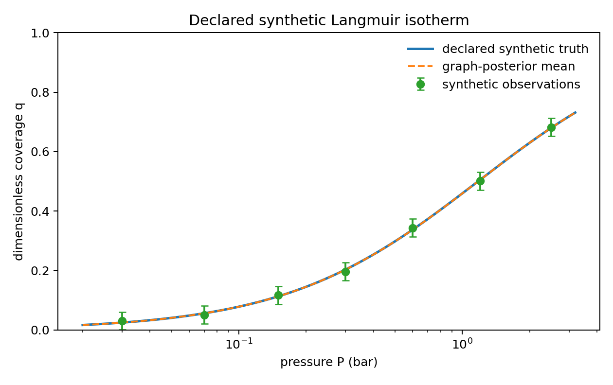
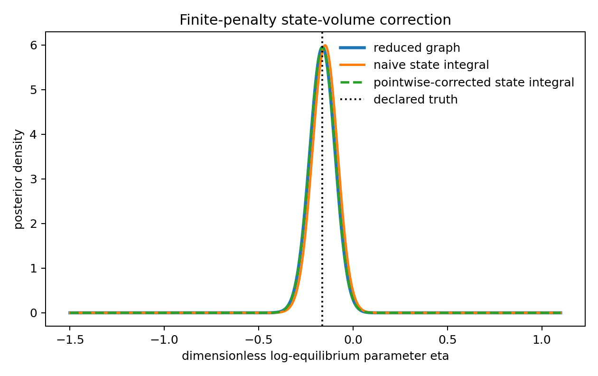

# Langmuir adsorption: nonlinear equilibrium correction

[Examples index](../README.md) ·
[Repository overview](../../README.md) ·
[Technical details](TECHNICAL_DETAILS.md)

This synthetic example shows detcorr recovering the intended graph target for
an exactly solvable nonlinear equilibrium constraint. Enforcing the constraint
as a narrow residual tube without its state-volume term moves the inferred
equilibrium parameter by `0.210` posterior standard deviations.

Here **graph target** means the posterior obtained after solving the equilibrium
constraint for coverage.

## Problem

For pressure `P` and coverage `q`, the dimensionless Langmuir constraint is

```math
c(\eta,q;P)=\log\!\left(\frac{q}{1-q}\right)-\log(KP)=0,
\qquad K=\frac{e^\eta}{\mathrm{bar}}.
```

Seven fixed synthetic observations span the rising part of the isotherm.
Solving the constraint gives `q=KP/(1+KP)`.



*The seven fixed observations cover the rising part of the declared synthetic
isotherm, where the nonlinear state derivative varies most clearly.*

## What detcorr changes

The state derivative is nonlinear,

```math
D_qc=\frac{1}{q(1-q)}.
```

A naive residual tube therefore carries a parameter-dependent state-volume
factor. The corrected calculation places `1/[q(1-q)]` inside the independently
evaluated state integral.

`L1` distance is the integrated absolute difference between two normalized
density curves; zero means exact agreement.

| Target | Mean `eta` | L1 distance from graph |
|---|---:|---:|
| Reduced graph | -0.16300 | 0 |
| Naive finite tube | -0.14895 | 0.16744 |
| detcorr finite tube | -0.16300 | `2.55e-4` |



*The detcorr state integral follows the blue solved-graph target; the naive tube
is shifted by nonlinear coverage-state volume.*

The corrected result is close rather than algebraically identical because the
penalty is finite. Independent 48-versus-64-node quadrature agrees to
`2.56e-13` in centered log density.

## Why it matters

When inference integrates a finite residual tube, exact feasibility does not
remove its surrounding-volume factor. For nonlinear equilibrium models,
detcorr preserves the posterior defined on the solved constraint graph and
prevents the residual coordinate from silently reweighting it.

## Run

From this directory:

```bash
python -m pip install \
  "detcorr @ git+https://github.com/Olsson-Materials-Modelling/detcorr.git@a414f063515359f70952e2717a506b75e69e4b0b"
python -m pip install -r requirements.txt
python src/adsorption_langmuir_equilibrium_demo.py \
  --outputs ../../regenerated/adsorption-langmuir
python -m pytest -q
```

## Scope and next step

This synthetic one-site equilibrium validation isolates nonlinear state-volume
geometry. A domain application can retain the same correction pattern while
supplying its own adsorption data, likelihood, and physical model.

[Machine-readable results](outputs/summary.json)
