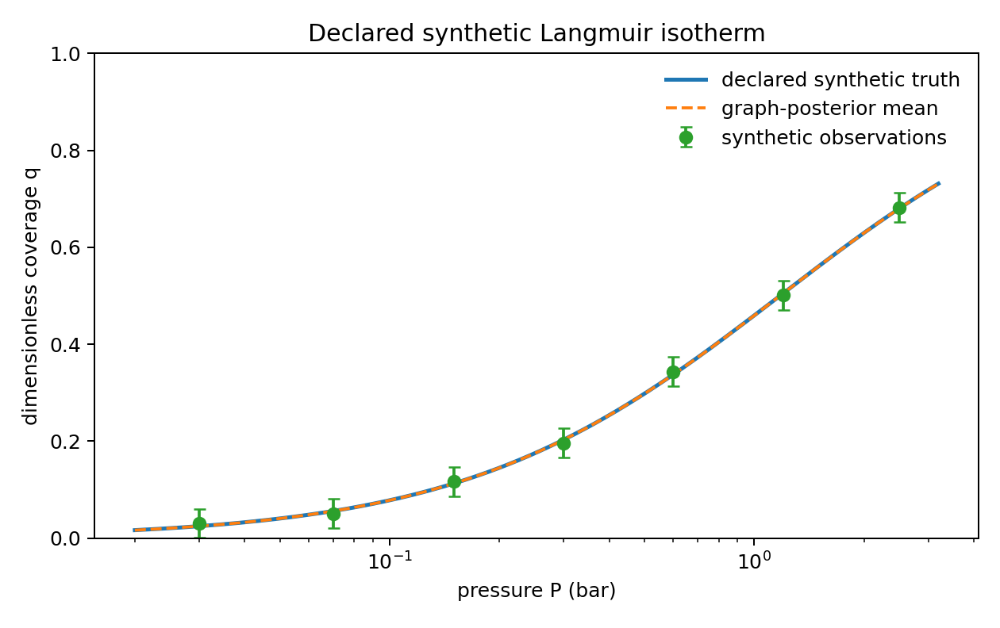
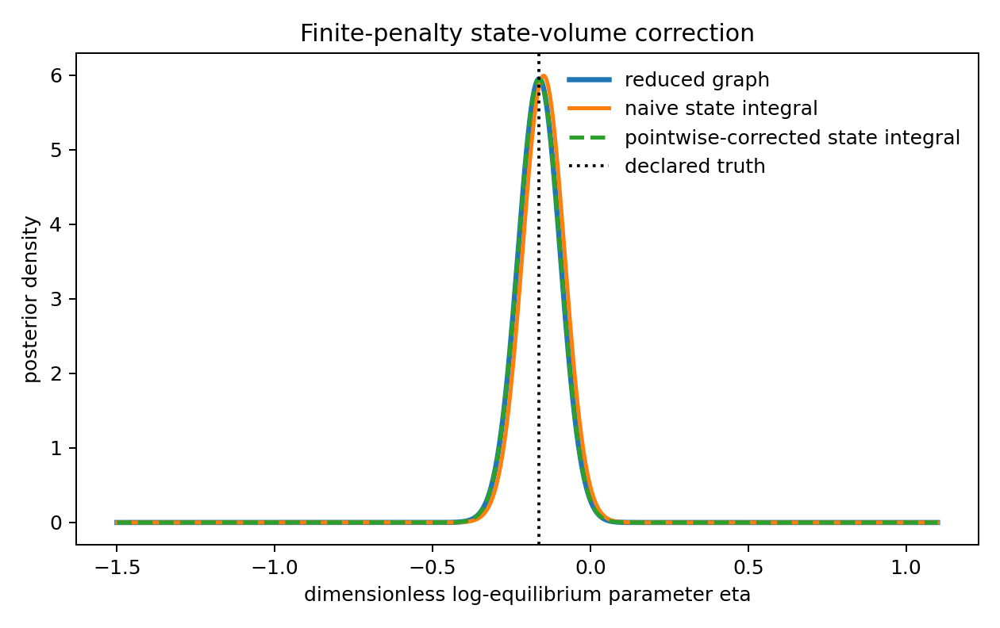

# Technical details: synthetic Langmuir adsorption equilibrium

[Back to the example overview](README.md)

This worked example shows why a nonlinear but exactly solvable state constraint
still needs an explicit volume correction when it is enforced through a narrow
residual tube. It is a **synthetic validation problem**, not an adsorption fit or
a claim about a particular material.

The truth, pressures, uncertainty, and observation offsets are fixed in
`data/SYNTHETIC_DESIGN.json` before inference. No random draw, experimental
dataset, trained predictor, or fitted preprocessing is used.

## Problem and units

The dimensionless equilibrium parameter is `eta`, with

```math
K = \frac{\exp(\eta)}{\mathrm{bar}}.
```

For pressure `P` in bar and dimensionless coverage `q` in `(0,1)`, the
constraint is

```math
c(\eta,q;P) = \log\!\left(\frac{q}{1-q}\right) - \log(KP) = 0.
```

Because `KP` is dimensionless, the logarithm is well defined. Solving the
constraint gives the Langmuir isotherm

```math
q(\eta,P) = \frac{KP}{1+KP},
```

and its state Jacobian is

```math
D_q c = \frac{1}{q(1-q)}.
```

The synthetic observations use seven pressures from `0.03` to `2.5` bar,
declared truth `K=0.85 bar^-1` (`eta_true=log(0.85)=-0.16252`), fixed coverage
offsets, and fixed dimensionless coverage uncertainty `sigma_q=0.03`.



## detcorr construction

The intended reduced graph target is a fixed `N(0,1)` prior for `eta` multiplied
by the Gaussian coverage likelihood evaluated at the solved state
`q(eta,P)=KP/(1+KP)`. The naive full-space tube instead integrates

```math
\int_0^1 L_i(q)\exp[-\rho c_i(\eta,q)^2/2]\,dq,
```

which carries a parameter-dependent state-volume factor. The corrected integral
places the determinant inside the integral,

```math
\int_0^1 L_i(q)\exp[-\rho c_i(\eta,q)^2/2]
              \frac{dq}{q(1-q)}.
```

The code evaluates both integrals directly in `q` using local Gauss--Legendre
quadrature. It does not construct the corrected curve by subtracting and adding
the same grid-level log determinant. The integration window spans ten residual
standard deviations; the penalty kernel's omitted two-sided Gaussian tail
fraction is below `1.6e-23`. A 48-node calculation is checked against a
higher-order 64-node reference.

## Outcome

For `rho=1e5`, the generated results are:

| Target | Mean `eta` | SD | L1 distance from graph |
|---|---:|---:|---:|
| Reduced graph | -0.16300 | 0.06705 | 0 |
| Naive finite-penalty state integral | -0.14895 | 0.06658 | 0.16744 |
| Pointwise determinant-corrected state integral | -0.16300 | 0.06707 | `2.55e-4` |



The naive mean is displaced by `0.210` graph-posterior standard deviations. The
corrected finite-penalty density recovers the graph density to an L1 error of
`2.55e-4`; it is not exactly equal because `rho` is finite. The 48-versus-64-node
centered log-density error is `2.56e-13`, so this remaining difference is a
finite-penalty effect rather than quadrature error. Across the deliberately
broad eta grid, the graph log correction varies by 8.071 log units.

The diagonal `detcorr` audit evaluates all seven entries of
`D_q c=1/[q(1-q)]` at the graph-posterior mode and agrees with the analytic log
determinant to machine precision.

## Identifiability and interpretation boundary

`eta` is identifiable here because it is a single shared parameter and the
pressures span the rising part of the isotherm rather than lying entirely in the
low-coverage or saturated limit. The calculation nevertheless assumes:

- a one-site equilibrium Langmuir model;
- independent homoscedastic Gaussian coverage errors;
- known pressure without calibration error;
- no lateral interactions, site heterogeneity, kinetics, temperature
  dependence, censoring, or model discrepancy.

The recovered truth validates this declared synthetic problem only. It is not
evidence that the same residual or likelihood is adequate for experimental
adsorption data.

## Run

From this directory, with `detcorr` installed or on `PYTHONPATH`:

```bash
python -m pip install -r requirements.txt
python src/adsorption_langmuir_equilibrium_demo.py \
  --outputs ../../regenerated/adsorption-langmuir
python -m pytest -q
```

The public output contract is strict JSON + CSV + PNG only:
`outputs/summary.json`, four CSV evidence tables, and the two figures above.

## Reproduction and evidence record

The run is deterministic. `data/SYNTHETIC_DESIGN.json` fixes the truth,
pressures, offsets and uncertainty before inference; changing that file defines
a different synthetic experiment and should use a separately retained output
directory.

For a source checkout, the fully explicit local command is:

```bash
export PYTHONPATH=../detcorr_demo_common/src:${PYTHONPATH:-}
python src/adsorption_langmuir_equilibrium_demo.py \
  --outputs ../../regenerated/adsorption-langmuir
DETCORR_EXAMPLES_REQUIRE_DETCORR=1 python -m pytest -q
```

The load-bearing validation is direct Gauss--Legendre integration in `q`, with
the determinant evaluated pointwise inside the corrected integrand. The
48-node result agrees with the 64-node reference to `2.56e-13` in centered log
density and `4.51e-14` in density L1. The public diagonal detcorr route returns
the analytic log determinant `15.181473518974066` with zero absolute error at
the audited parameter value.

Principal evidence:

- `outputs/summary.json` — strict machine-readable model, outcomes and checks;
- `outputs/tables/posterior_targets.csv` — graph, naive and corrected summaries;
- `outputs/tables/quadrature_convergence.csv` — node-order convergence;
- `outputs/tables/graph_logdet_on_grid.csv` — determinant values on the graph;
- `outputs/tables/synthetic_observations.csv` — the declared synthetic data;
- `outputs/posterior_eta_targets.png` and
  `outputs/synthetic_langmuir_isotherm.png` — generated figures.
