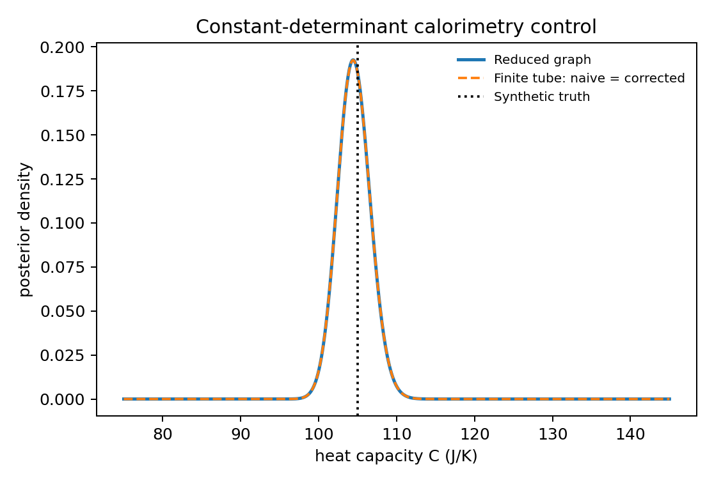
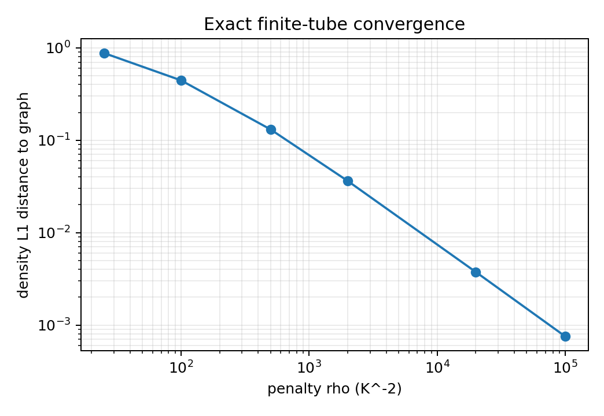

# Calorimetry: a zero-correction control

[Examples index](../README.md) ·
[Repository overview](../../README.md) ·
[Technical details](TECHNICAL_DETAILS.md)

This synthetic control demonstrates when detcorr should make no change. The
temperature-state Jacobian is constant, so the naive and corrected finite
tubes coincide exactly and both approach the graph posterior as the constraint
penalty increases.

Here **graph target** means the posterior obtained after solving the
temperature-rise constraint exactly.

## Problem

A known heat input `Q` produces a temperature rise through

```math
\Delta T=\frac{Q}{C},
\qquad c(C,\Delta T)=\Delta T-\frac{Q}{C}.
```

Here `Q=420 J`, the declared truth is `C=105 J/K`, and the fixed synthetic
temperature observation has standard deviation `0.08 K`.

## What detcorr changes

The state derivative is

```math
D_{\Delta T}c=1,
\qquad \log|\det D_{\Delta T}c|=0.
```

The correction range is therefore exactly zero. Naive and corrected posterior
means are both `104.54595 J/K`, and their density L1 difference is exactly
zero. `L1` is the integrated absolute difference between normalized density
curves.



*The naive and corrected curves overlap because the state determinant is a
parameter-independent constant.*

Their small difference from the hard graph target is solely a finite-penalty
effect and decreases systematically with increasing penalty.



*Increasing the penalty removes the remaining finite-tube approximation error
without creating a determinant effect.*

## Why it matters

The determinant correction responds specifically to parameter-dependent state
volume. This zero-effect control shows that detcorr leaves a constant-volume
constraint unchanged.

## Run

From this directory:

```bash
python -m pip install \
  "detcorr @ git+https://github.com/Olsson-Materials-Modelling/detcorr.git@a414f063515359f70952e2717a506b75e69e4b0b"
python -m pip install -r requirements.txt
python src/calorimetry_constant_determinant_control_demo.py \
  --outputs ../../regenerated/calorimetry-control
python -m pytest -q tests
```

## Scope and next step

This synthetic constant-heat-capacity control verifies the expected zero
correction when state volume is constant. The same control is useful when
validating a richer experimental calorimetry model.

[Machine-readable results](outputs/summary.json)
