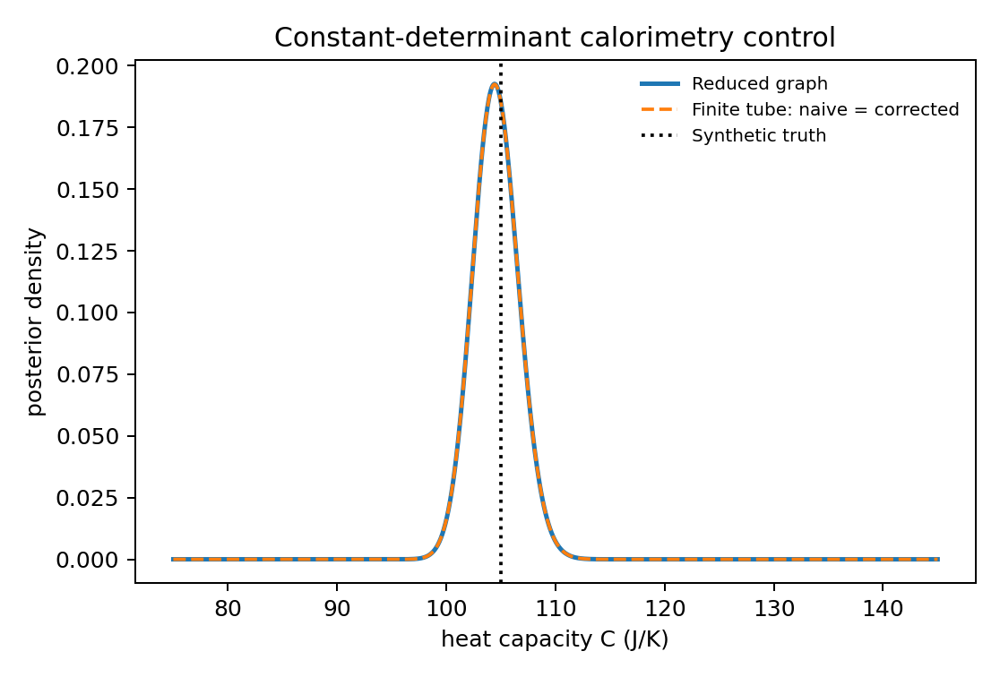
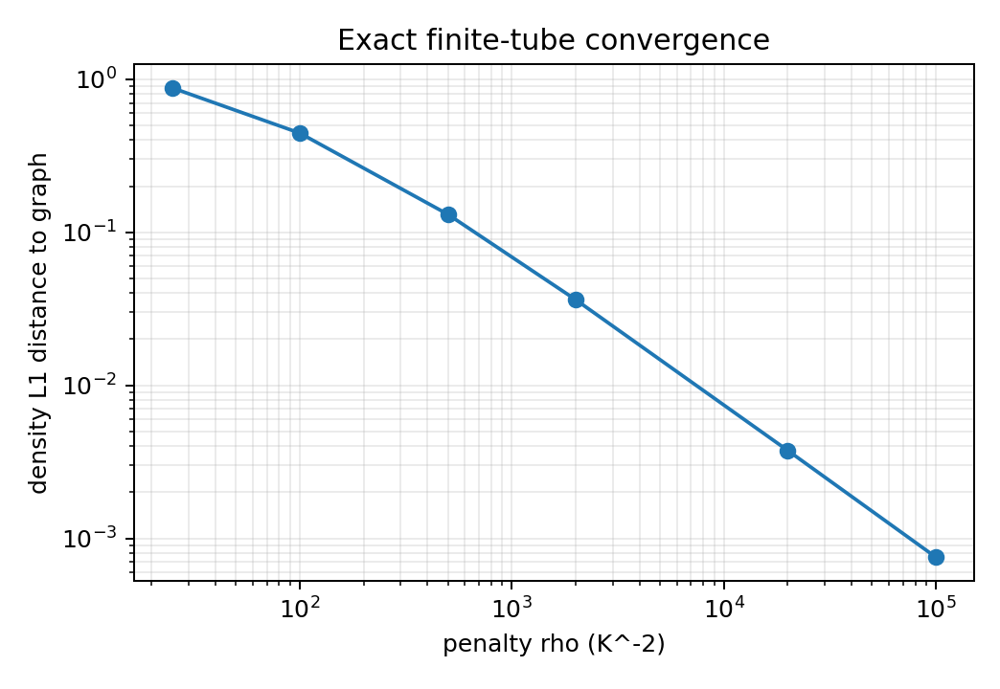

# Technical details: calorimetry constant-determinant control

[Back to the example overview](README.md)

This synthetic worked control shows the case in which determinant correction
is mathematically present but identically zero. It is not an experimental
calorimetry result.

## Problem

A known heat input \(Q\), measured in joules, is applied to a body with heat
capacity \(C\), measured in J/K. The latent state is the temperature rise
\(\Delta T\) in kelvin:

```math
\Delta T=\frac{Q}{C},
\qquad
c(C,\Delta T)=\Delta T-\frac{Q}{C}.
```

The equation is dimensionally consistent and

```math
D_{\Delta T}c=1,
\qquad
\log|\det D_{\Delta T}c|=0.
```

The finite-penalty term is \(-\rho c^2/2\), where \(c\) is in K and
\(\rho\) is in K\(^{-2}\). The reduced target is a graph posterior with
respect to \(dC\).

Synthetic data use `Q = 420 J`, `C_true = 105 J/K`, a declared observation
standard deviation of `0.08 K`, and one fixed `+0.30 sigma` offset. No random
draw is hidden in the stored outcome.

## Outcome and independent check

The observation likelihood and constraint penalty are both Gaussian in
\(\Delta T\), so the script integrates the full-space target over the state
exactly. Because the correction is zero, the naive and corrected finite tubes
are equal point by point. At finite \(\rho\), both differ slightly from the
hard graph target; that approximation vanishes as \(\rho\) increases.



The convergence calculation changes only the constraint penalty. It does not
define the corrected result by subtracting and restoring the same determinant.
The API audit also receives the residual as a callable and computes its state
Jacobian by central finite differences rather than being handed `logdet=0`.



## Run and verify

From this directory, with `detcorr` installed:

```bash
python src/calorimetry_constant_determinant_control_demo.py \
  --outputs ../../regenerated/calorimetry-control
python -m pytest -q tests
```

The generated `summary.json` records an exactly zero correction range and
exactly zero naive-versus-corrected difference. The public output contract is
strict JSON + CSV + PNG only: two CSV tables contain the posterior summaries
and penalty-convergence audit, and two PNGs show the result.

## Interpretation limits

- The heat capacity, truth, and observation are synthetic.
- Heat input is treated as exact; heat loss and calorimeter addenda are absent.
- \(C\) is assumed constant over the small temperature interval.
- The example validates a constant-determinant control, not experimental
  material characterization.

## Prior, likelihood and numerical contract

The graph target is a density with respect to `dC` on `C>0`. It uses the
positive-truncated Gaussian kernel with mean `110 J/K` and standard deviation
`22 J/K`; its parameter-independent truncation normalizer is omitted. The
Gaussian likelihood for the observed temperature rise has fixed standard
deviation `0.08 K`.
The constraint residual is in kelvin, so the committed penalty
`rho=1e5 K^-2` makes `rho*c^2` dimensionless.

The full-space marginal is evaluated by exact scalar Gaussian integration over
`Delta T`. The convergence audit uses
`rho = 25, 100, 500, 2e3, 2e4, 1e5 K^-2`; only the constraint penalty changes.
The callable detcorr audit obtains the state derivative by finite differences
and returns a correction within `1.78e-11` of zero.

## Reproduction and evidence record

The script and tests use no random draw. The fixed `+0.30 sigma` observation
offset is declared in the source.

Principal evidence:

- `outputs/summary.json` — strict machine-readable parameters, checks and result;
- `outputs/tables/posterior_summaries.csv` — graph and finite-tube summaries;
- `outputs/tables/rho_convergence.csv` — penalty-convergence audit;
- `outputs/calorimetry_constant_determinant_posteriors.png` and
  `outputs/finite_penalty_convergence.png` — generated figures.
