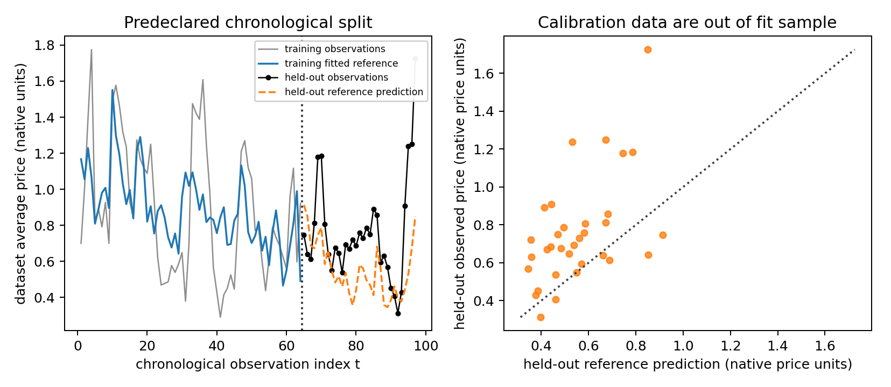
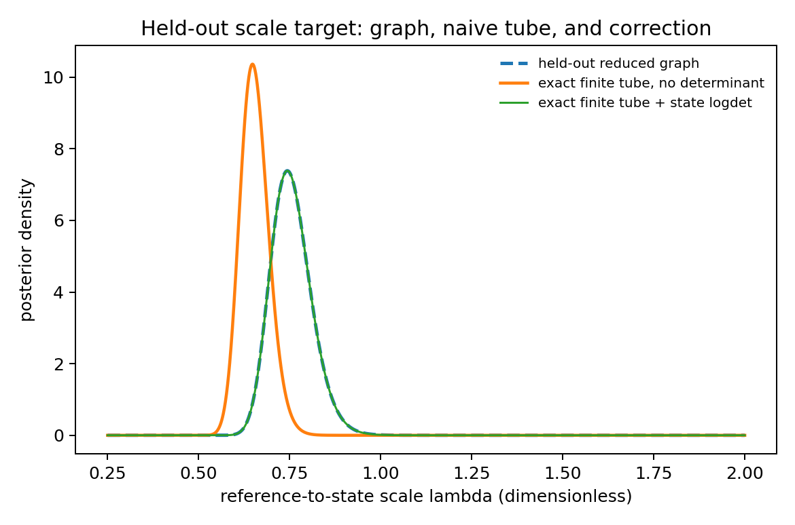

# Fulton market: held-out price-scale calibration

[Examples index](../README.md) ·
[Repository overview](../../README.md) ·
[Technical details](TECHNICAL_DETAILS.md)

This example uses the publicly sourced 97-observation Fulton fish-market table
and a chronological held-out design to isolate a real-data scale calibration.
`detcorr` recovers the requested target; omitting repeated state volume moves
the scale by `-1.809` posterior standard deviations.

Here **graph target** means the posterior obtained after solving the latent
price constraint. The multiplicative scale is `lambda`.

## Problem

Observations 1–64 fit a reduced-form price reference from weather, weekday and
time variables. Observations 65–97 are held out and alone enter the calibration
likelihood.



*The first 64 prices fit the reference; only the later 33 prices enter the
calibration likelihood.*

For held-out reference `a_t`, latent dimensionless price `u_t`, and scale
`lambda`, the constraint is

```math
c_t(\lambda,u_t)=a_t-\lambda u_t=0,
\qquad D_uc=-\lambda I.
```

Across 33 held-out states, the determinant contribution is
`33 log(lambda)`.

## Result

All latent price states are integrated independently with an exact Gaussian
formula.

| Target | Mean `lambda` | Shift from graph |
|---|---:|---:|
| Reduced graph | 0.755391 | 0 SD |
| Naive finite tube | 0.654575 | -1.809 SD |
| detcorr finite tube | 0.755391 | approximately 0 SD |



*The corrected finite tube follows the solved-graph scale target, while repeated
omitted state volume shifts the naive posterior downward.*

The corrected density has L1 error `2.46e-7` from the graph target, while the
naive density differs by `1.438`. `L1` is the integrated absolute difference
between normalized density curves.

## Why it matters

Small per-state volume effects accumulate when a shared parameter controls many
latent states. detcorr prevents that accumulation from masquerading as evidence
about the calibration parameter.

## Run

From this directory:

```bash
python -m pip install \
  "detcorr @ git+https://github.com/Olsson-Materials-Modelling/detcorr.git@a414f063515359f70952e2717a506b75e69e4b0b"
python -m pip install -r requirements.txt
python src/fulton_market_detcorr_demo.py \
  --outputs ../../regenerated/fulton-demonstrator
python -m pytest -q
```

## Scope and next step

This is a chronological conditional-calibration demonstrator. The linked
scientific case study adds rolling prediction, dependence sensitivity, and the
evidence needed to assess the result as an economic workflow.

[Machine-readable results](outputs/summary.json) ·
[Extended scientific case study](../../case_studies/studies/fulton_market/README.md)
