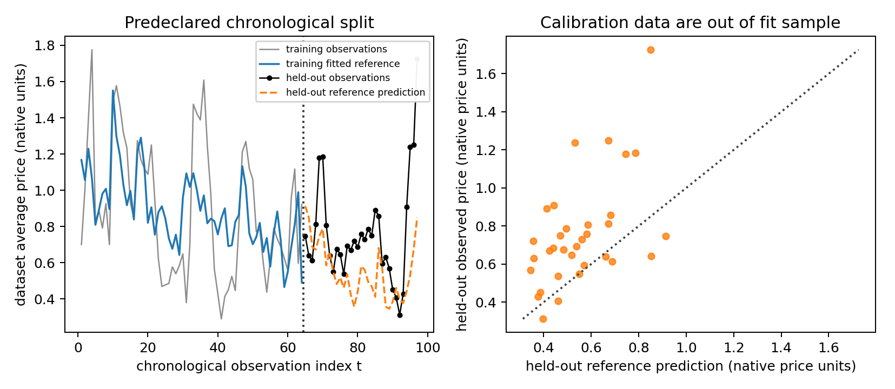
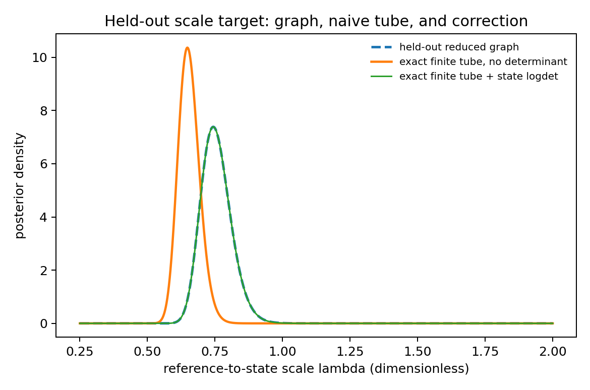
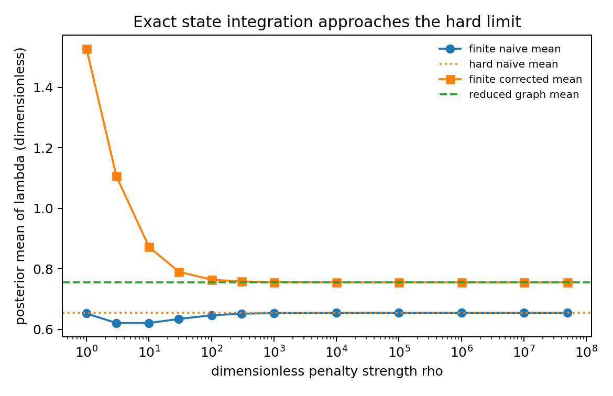

# Technical details: held-out Fulton price-scale calibration

[Back to the example overview](README.md)

This worked example uses the 97-observation Wooldridge/Graddy Fulton fish-price
table to show a determinant correction on real, openly distributed data. It is
a deliberately simplified held-out calibration problem, not a structural
model of the Fulton market.

## Problem: avoid fitting and testing on the same prices

Using the same observations to fit the price reference and evaluate calibration
would force the scale parameter close to one through OLS orthogonality. The
chronological split prevents that construction:

- observations 1–64 fit a reduced-form price reference from weather, weekday
  indicators, and a time trend;
- observations 65–97 are held out from that fit and alone form the calibration
  likelihood;
- the training mean price fixes the state coordinate, and the training residual
  SD is used as a plug-in likelihood scale.



The plot makes the separation visible. The held-out observations influence the
posterior but not the fitted reference, its coefficients, the plug-in SD, or the
nondimensionalizing price scale.

## Model: a conditional dimensionless scale

Let `a_t` be the held-out reference prediction divided by the mean training
price, and let `u_t` be a latent price in the same dimensionless coordinate. We
declare

```text
c_t(lambda, u_t) = a_t - lambda u_t = 0,
u_t(lambda) = a_t/lambda,
D_u c = -lambda I,
log |det D_u c| = 33 log(lambda).
```

Here `lambda` is only a dimensionless reference-to-state calibration factor.
It is not an elasticity, market-power coefficient, causal response, or supply
or demand parameter.

The reduced graph target uses an iid Gaussian likelihood for the 33 held-out
prices and a lognormal prior for `lambda`. The Gaussian likelihood is a compact
demonstrator assumption: it does not model serial dependence,
heteroskedasticity, or forecast discrepancy.

The default prior is a density with respect to `d lambda`:

```text
log(lambda) ~ Normal(0, 0.5^2),
p(lambda) = exp[-(log lambda)^2/(2 * 0.5^2)]
            / (lambda * 0.5 * sqrt(2 pi)),   lambda > 0.
```

The reduced target is therefore a density relative to `d lambda`. The
finite-penalty full-space density is relative to the product Lebesgue measure
`d lambda product_t du_t`, where every `u_t` is the dimensionless held-out
price coordinate. The determinant term converts narrow-tube volume in this
declared state coordinate to the graph target; it is not a coordinate-free
probability factor by itself.

## Solution: integrate the price states independently

The full-space finite-penalty target is

```text
prior(lambda) N(y | u, sigma^2 I)
exp[-rho ||a - lambda u||^2 / 2].
```

The script integrates all 33 state coordinates with a stable, exact Gaussian
convolution formula. This calculation does not start from the reduced graph
density. It supplies an independent check of both limiting routes:

```text
naive tube       -> graph density - 33 log(lambda),
corrected tube   -> graph density.
```

The public callable `detcorr` route separately differentiates the residual and
recovers `33 log(lambda)` from the state Jacobian.



For the pinned data, split, prior, grid, and penalty:

- graph mean: `0.755391`, graph SD: `0.055732`;
- naive exact-tube mean: `0.654575`, a shift of `-1.809` graph SD;
- corrected exact-tube mean: `0.755391`;
- corrected-versus-graph density L1 error: `2.46e-7`;
- naive-versus-graph density L1 difference: `1.438`.

These numbers quantify a target-measure effect inside the declared calibration
model. They are not estimates to cite as Fulton-market economics.



## What is checked

The tests and machine-readable summary verify:

- the SHA256-pinned CSV and disjoint chronological split;
- that perturbing held-out prices leaves the training fit and reference
  predictions unchanged;
- the constraint solution and directional state derivative;
- the exact scalar Gaussian formula against direct numerical quadrature;
- exact 33-state integration against the independently solved graph target;
- the callable `detcorr` Jacobian/log-determinant result;
- negligible posterior mass at both grid boundaries;
- sensitivity to three prior widths and three chronological split points.

The sensitivity table is a demonstrator diagnostic, not a model-selection or
forecast-validation study.

## Run

From this directory, with `detcorr` installed:

```bash
python src/fulton_market_detcorr_demo.py \
  --outputs ../../regenerated/fulton-demonstrator
python -m pytest -q
```

From the repository root:

```bash
python examples/econometrics_fulton_market/src/fulton_market_detcorr_demo.py \
  --outputs regenerated/fulton-demonstrator
```

The script accepts `--outputs`, `--data`, `--train-size`, `--n-grid`, and
`--rho`. Changing the split changes the conditional calibration problem and is
reported explicitly; it is not silently treated as the same estimate.

## Data provenance and licence boundary

The bundled `data/fish.csv` is a pinned Rdatasets export of the `fish` table
from the CRAN `wooldridge` package. The upstream table documentation attributes
the data to K. Graddy, *Testing for Imperfect Competition at the Fulton Fish
Market*, RAND Journal of Economics 26 (1995), 75–92.

The official `wooldridge` data package distributes `fish` as package content
and declares GPL-3. The CSV is conveyed separately under GPL-3 to the extent
that package licence applies, while the Rdatasets caveat about underlying
rights is retained. The repository MIT licence does not cover the fixture.
The source, retrieval route, byte identity, transformation, schema, attribution,
and rights boundary are recorded in
[`data/FIXTURE_MANIFEST.json`](data/FIXTURE_MANIFEST.json); redistribution must
also retain the qualified Fulton notice in
[`../../THIRD_PARTY_NOTICES.md`](../../THIRD_PARTY_NOTICES.md) and the GPL-3
text identified there.

## Outputs

The public output contract is strict JSON + CSV + PNG only.

- `outputs/summary.json`: strict JSON model, provenance, checks, limitations,
  outcome, and callable API audit;
- `outputs/tables/posterior_summaries.csv`: graph, naive, and corrected
  posterior summaries;
- `outputs/tables/finite_penalty_validation.csv`: independent state-integral
  comparison at representative parameter values;
- `outputs/tables/finite_penalty_convergence.csv`: penalty convergence;
- `outputs/tables/prior_and_split_sensitivity.csv`: declared sensitivity
  cases;
- `outputs/tables/heldout_predictions.csv`: auditable held-out inputs; and
- `outputs/heldout_price_reference.png`, `outputs/heldout_scale_posteriors.png`,
  and `outputs/finite_penalty_convergence.png`: generated figures.

## Interpretation boundary

This example demonstrates that a repeated parameter-dependent state derivative
can materially change a held-out calibration posterior if its volume factor is
omitted. It does not propagate reduced-form fitting uncertainty, establish an
optimal time-series model, identify structural supply or demand, estimate
market power, or support a causal or population-level empirical conclusion.

## Reproduction and evidence record

The default calculation is deterministic: the first 64 chronological rows set
the reference fit and the final 33 rows set the likelihood. Posterior
normalization uses grid integration and every latent price state is integrated
analytically; no sampler or random seed is involved.

The bundled `data/fish.csv` SHA256 is:

```text
fa51db236cb3f9e7040cdc50b002542bcbb3d51077132848d1960a996ec9b3c9
```

To regenerate without replacing the committed evidence:

```bash
python src/fulton_market_detcorr_demo.py \
  --outputs ../../regenerated/fulton-heldout-output
```

The tests verify the pinned file and disjoint split, held-out isolation,
constraint solution and derivative, scalar quadrature formula, complete
33-state integral, callable detcorr result, grid support, and the declared
prior/split sensitivity cases. Exact values are retained in
`outputs/summary.json` and the tables listed above.

The corresponding expanded scientific analysis, including dependence-aware
claims, is [the Fulton market case study](../../case_studies/studies/fulton_market/README.md).
