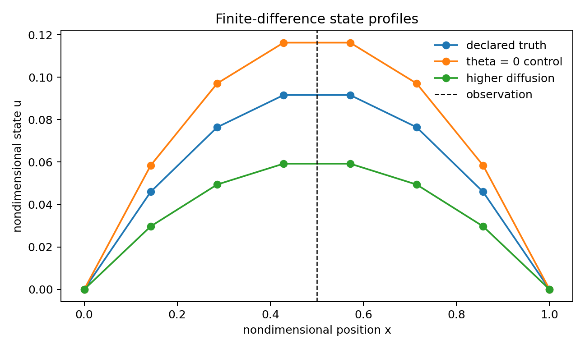
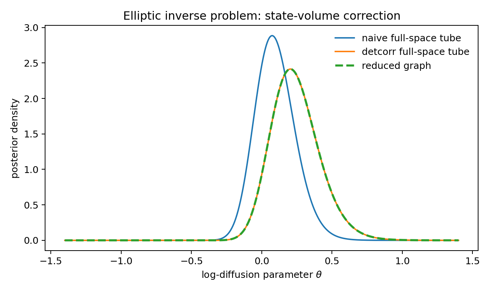

# Elliptic partial differential equation (PDE): discretized state-volume correction

[Examples index](../README.md) ·
[Repository overview](../../README.md) ·
[Technical details](TECHNICAL_DETAILS.md)

This synthetic example shows detcorr restoring the coefficient posterior
defined on a solved discretized PDE. The operator determinant is part of that
target; omitting it shifts the inferred coefficient by `-0.832` posterior
standard deviations.

Here **graph target** means the posterior obtained after solving the discrete
PDE for its state vector.

## Problem

On the nondimensional interval `0<x<1`,

```math
-e^\theta u''(x)+0.5u(x)=1,
\qquad u(0)=u(1)=0.
```

Six interior states use a centered second-order stencil. A fixed midpoint
observation is generated from the declared value `theta*=0.25`.



*The fixed midpoint observation distinguishes coefficient values through their
solved discrete state profiles.*

## What detcorr changes

The discrete residual is

```math
c(\theta,u)=A(\theta)u-f,
\qquad D_uc=A(\theta).
```

The determinant of `A(theta)` changes across the parameter range, so the
intended graph posterior requires the corresponding state-volume correction.

`L1` distance is the integrated absolute difference between two normalized
density curves; zero means exact agreement.

| Target | Mean `theta` | L1 distance from graph |
|---|---:|---:|
| Reduced graph | 0.24192 | 0 |
| Naive finite tube | 0.09832 | 0.70325 |
| detcorr finite tube | 0.24192 | `3.72e-5` |



*The corrected full-state route follows the solved-PDE target; omitting the
operator determinant shifts the posterior.*

The full six-state Gaussian integral is evaluated analytically and the detcorr
value agrees exactly with an independent Cholesky log determinant.

## Why it matters

When inverse PDE inference integrates a finite residual tube, exact feasibility
does not remove the state operator's surrounding-volume factor. detcorr makes
that geometric contribution explicit and testable.

## Run

From this directory:

```bash
python -m pip install \
  "detcorr @ git+https://github.com/Olsson-Materials-Modelling/detcorr.git@a414f063515359f70952e2717a506b75e69e4b0b"
python -m pip install -r requirements.txt
python src/elliptic_pde_demo.py \
  --outputs ../../regenerated/elliptic-pde
python -m pytest -q tests
```

## Scope and next step

This nondimensional six-state discretization validates the operator-determinant
correction. A scientific PDE application can extend the same construction with
mesh convergence, observations, and an application-specific uncertainty model.

[Machine-readable results](outputs/summary.json)
