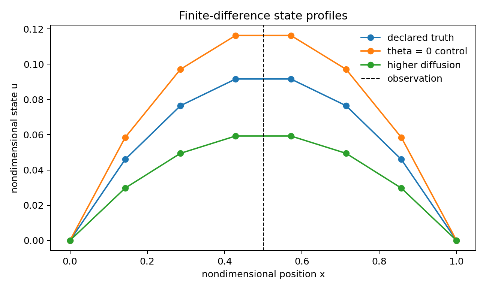
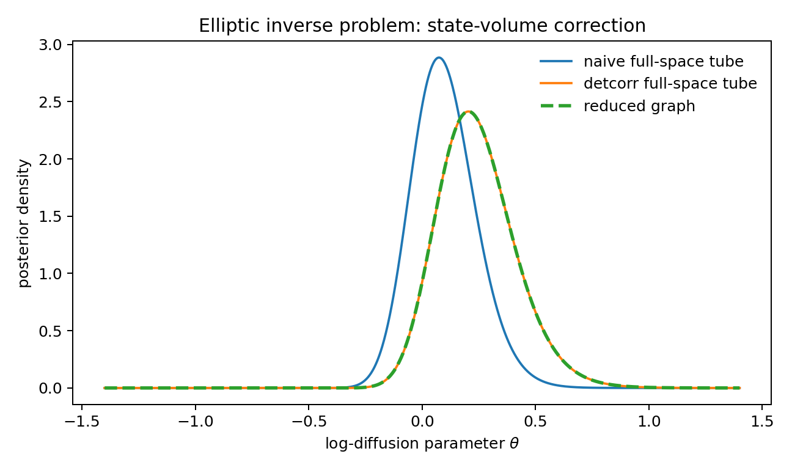

# Technical details: elliptic PDE coefficient inference

[Back to the example overview](README.md)

This transparent synthetic example asks how a diffusion coefficient should be
inferred when the discretized PDE state is imposed through a narrow residual
tube. It is a consistency demonstrator, not an empirical PDE result.

## Problem

On the nondimensional interval `0 < x < 1`, the state satisfies

```math
-\exp(\theta)u''(x)+0.5u(x)=1,
\qquad u(0)=u(1)=0.
```

Six interior unknowns use the centred second-order `1/h^2` stencil. A midpoint
observation is generated once from the declared value `theta*=0.25`, with a
fixed `+0.25 sigma` offset. The inference code receives only that fixed datum;
the truth is retained solely for provenance and coverage checks.
The reduced target is a graph posterior with respect to \(d\theta\).



## Correction driver

The discrete constraint is

```math
c(\theta,u)=A(\theta)u-f=0,
```

so `D_u c=A(theta)`. Its determinant changes strongly across the parameter
grid. The reduced graph posterior is compared with two independently integrated
full-space Gaussian tubes: one omits `log|det A|`, and one includes it.



The corrected posterior mean differs from the reduced mean by about
`1.5e-6`, while the naive mean moves by roughly `0.14` in theta. The exact
numbers and density distances are recorded in `outputs/summary.json`.

## Why this is defensible

- The finite-difference operator includes the declared `1/h^2` scaling and a
  manufactured quadratic-state check.
- The full state is integrated analytically rather than defining the corrected
  curve by subtracting and restoring the determinant.
- `detcorr` is audited against an independent SPD-Cholesky log determinant.
- The model, state, forcing, and coordinates are nondimensional, so no hidden
  unit conversion enters the penalty.

The six-state dense route is deliberately a validation reference. A production
PDE application should use sparse factorization or a calibrated matrix-free
estimator and must supply real observation provenance and discretization-error
analysis.

## Run

From the bundle root with `detcorr` installed or on `PYTHONPATH`:

```bash
python examples/elliptic_pde_1d/src/elliptic_pde_demo.py \
  --outputs regenerated/elliptic-pde
python -m pytest -q examples/elliptic_pde_1d/tests
```

## Prior, likelihood and numerical contract

The graph target is a density with respect to `d theta`. It uses the Gaussian
prior `theta ~ Normal(0, 1.15^2)` and one interpolated midpoint observation with
fixed standard deviation `0.015`. The observation is generated once from
`theta*=0.25` with a fixed `+0.25 sigma` offset.

The six-state model uses `h=1/7`, the parameter interval `[-1.4,1.4]`, a
1,001-point grid and the nondimensional penalty `rho=1e5`. State, forcing,
residual and coordinates are all nondimensional. The graph state is obtained
by solving `A(theta)u=f`; the independent finite-tube route analytically
integrates the full Gaussian state.

## Validation and outputs

The centered `1/h^2` stiffness is checked against a manufactured quadratic
state. The maximum solved residual norm is `3.35e-15`, and the detcorr log
determinant agrees exactly with an independent SPD-Cholesky calculation.

The public output contract is strict JSON + CSV + PNG only.

Principal evidence:

- `outputs/summary.json` — strict model, posterior and independent-validation record;
- `outputs/tables/posterior_routes.csv` — all three normalized targets;
- `outputs/elliptic_state_profiles.png` — state and observation geometry;
- `outputs/elliptic_posterior_routes.png` — graph, naive and corrected routes.
