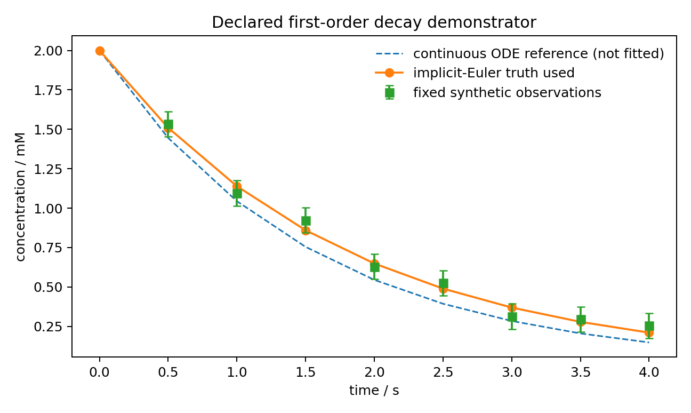
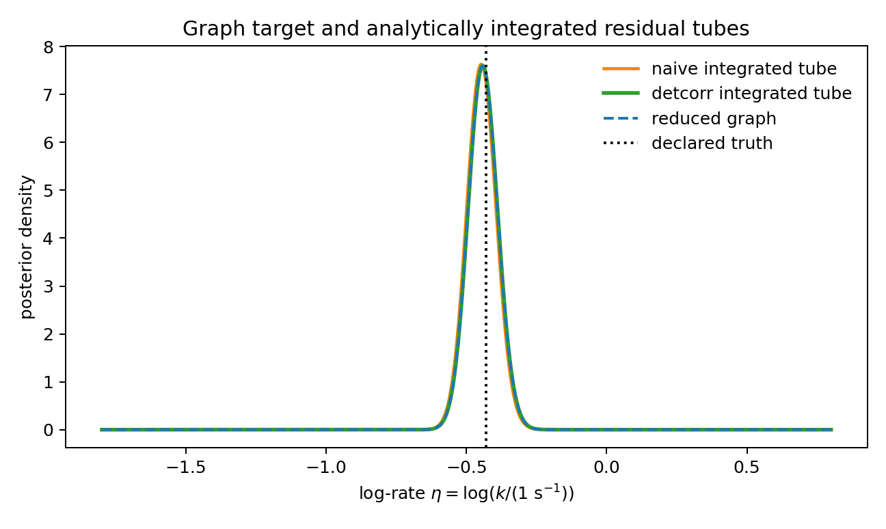

# First-order decay: a time-stepping constraint

[Examples index](../README.md) ·
[Repository overview](../../README.md) ·
[Technical details](TECHNICAL_DETAILS.md)

This synthetic example shows the corrected finite tube recovering the graph
target for an eight-state implicit-Euler trajectory. A feasible time-stepped
solution still carries parameter-dependent state volume; omitting it shifts the
log-rate by `-0.102` posterior standard deviations.

Here **graph target** means the posterior obtained after solving the declared
implicit-Euler recurrence for the full trajectory.

## Problem

The continuous motivation is first-order decay, but inference uses the declared
implicit-Euler recurrence

```math
c_i(\eta,u)=u_i-u_{i-1}+\Delta t\,k u_i=0,
\qquad k/(1\ \mathrm{s}^{-1})=e^\eta.
```

The fixed synthetic trajectory uses `dt=0.5 s`, eight observed states and a
declared rate `k=0.65 s^-1`.



*Inference uses the discrete trajectory; the continuous curve is shown only to
make the time-discretization choice visible.*

## What detcorr changes

The state Jacobian is lower triangular, giving

```math
\log|\det D_uc|=n\log(1+\Delta t\,k).
```

Across the parameter grid this correction changes by `5.34871` log units.

`L1` distance is the integrated absolute difference between two normalized
density curves; zero means exact agreement.

| Target | Mean `eta` | L1 distance from graph |
|---|---:|---:|
| Reduced graph | -0.440843 | 0 |
| Naive finite tube | -0.446197 | 0.081348 |
| detcorr finite tube | -0.440843 | `3.55e-6` |



*The detcorr finite tube follows the solved-trajectory target, removing the
preference introduced by the triangular time-step Jacobian.*

The full latent trajectory is integrated independently as a multivariate
Gaussian; dense, triangular and public detcorr determinant routes agree.

## Why it matters

Time discretization defines more than a trajectory solver: it also defines how
volume around that trajectory changes with the inferred parameter. detcorr
removes that unintended numerical preference.

## Run

From this directory:

```bash
python -m pip install \
  "detcorr @ git+https://github.com/Olsson-Materials-Modelling/detcorr.git@a414f063515359f70952e2717a506b75e69e4b0b"
python -m pip install -r requirements.txt
python src/kinetics_decay_time_stepping_demo.py \
  --outputs ../../regenerated/kinetics-decay
python -m pytest -q
```

## Scope and next step

This synthetic implicit-Euler model isolates the state volume created by a
time-stepping constraint. Experimental use can retain the correction while
adding the appropriate rate law, mechanism, and uncertainty model.

[Machine-readable results](outputs/summary.json)
