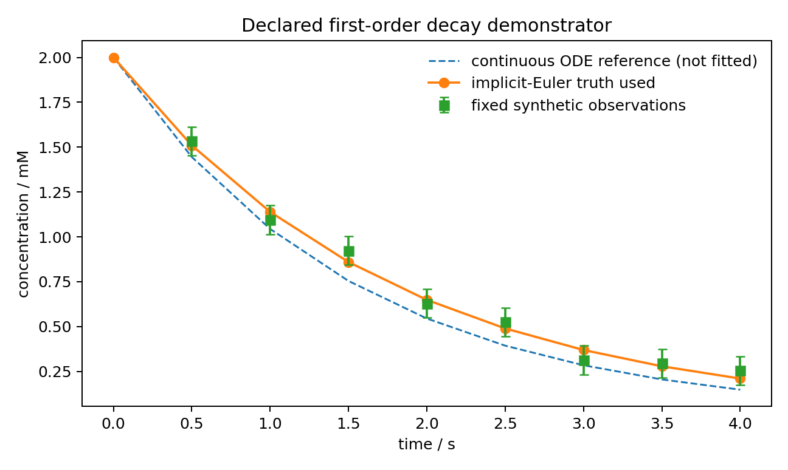
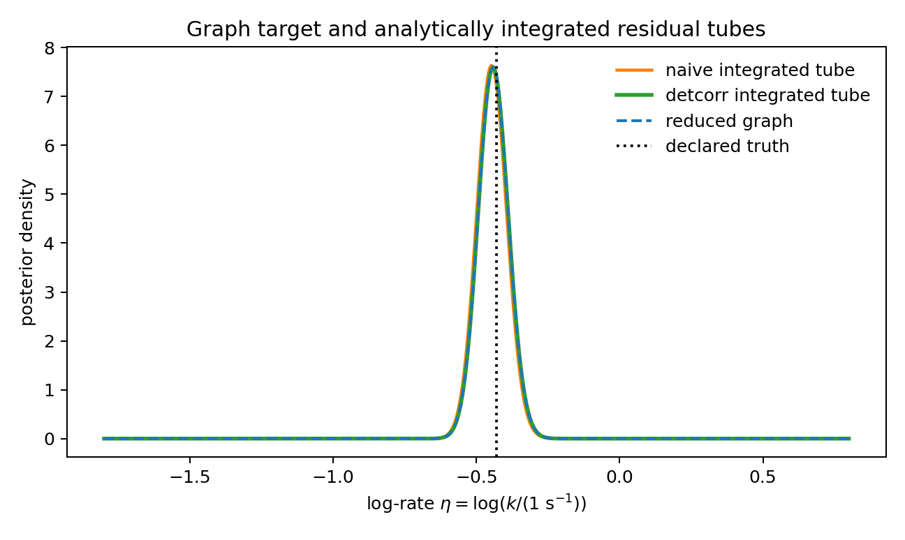

# Technical details: first-order decay through an implicit time-stepping constraint

[Back to the example overview](README.md)

This worked example shows why a time-stepping residual can change a posterior
even when every trajectory is feasible. It uses a deliberately small first-order
decay model so that the recurrence, determinant, and full-space state integral
are all available independently and exactly.

The data are transparent synthetic controls, not experimental kinetics. They
are generated from a declared discrete truth plus fixed offsets written in the
source; no random draw, fitted predictor, or hidden preferred answer is used.

## Problem and declared synthetic trajectory

The continuous motivation is

```math
\frac{du}{dt}=-ku, \qquad k>0.
```

The executable model is its implicit-Euler recurrence at
`dt = 0.5 s`:

```math
c_i(\eta,u)=u_i-u_{i-1}+\Delta t\,k u_i=0,
\qquad k/(1\ \mathrm{s}^{-1})=e^\eta.
```

Thus `eta` is dimensionless, the numerical value of `k` is in `s^-1`, and
`u` and `c` are in mM. The fixed initial concentration is `2.0 mM`; there are
eight inferred states. The manufactured truth is
`k = 0.65 s^-1` (`eta = -0.430783`). Observations use `sigma = 0.08 mM` and
the predeclared standardized offsets

```text
[0.30, -0.55, 0.80, -0.25, 0.45, -0.70, 0.20, 0.55].
```

The prior is the deliberately broad `eta ~ Normal(0, 1)` density with respect
to `d eta`; it is not centred on the manufactured truth.



The dashed continuous curve is shown only to expose the discretization error.
It is not used to generate or fit the observations: the discrete implicit-Euler
trajectory is the stated inference model.

## Why a correction is required

Writing the state vector as `u=(u_1,...,u_n)`, the residual is affine in `u`:

```math
c(\eta,u)=A(\eta)u-b,
```

where `A` is lower bidiagonal, with `-1` below the diagonal and

```math
A_{ii}=1+\Delta t\,k.
```

Therefore

```math
\log|\det D_u c|
=n\log(1+\Delta t\,k).
```

The derivative is dimensionless because both the state and residual use mM.
Across the plotted eta grid, this correction changes by `5.34871` log units.
A naive tube contains the reciprocal state-volume factor and consequently
favours smaller `eta` and slower decay.

## Independent full-space calculation

The graph target solves the recurrence and evaluates the observation likelihood
at `u=G(eta)`. The independent full-space target is

```math
\pi_\rho(\eta,u)\propto
\pi(\eta)
\exp\!\left[-\frac{\|u-y\|^2}{2\sigma^2}
-\frac{\rho}{2}\|A(\eta)u-b\|^2\right],
```

with `rho = 1e8 mM^-2`. Conditional on `eta`, this is a multivariate Gaussian
in `u`. The code forms its precision matrix

```math
Q=\sigma^{-2}I+\rho A^\mathsf{T}A
```

and integrates over every state analytically. The quadratic is evaluated at its
minimizer, avoiding cancellation between large completed-square terms. This is
an independent route: the naive tube is not defined by subtracting the
determinant from the graph density. The corrected tube then adds the separately
calculated triangular log determinant. Here `rho` is a numerical
hard-constraint precision, not a fitted kinetic-noise parameter.

## Outcome

| Target | Mean `eta` | SD `eta` | Mean rate (`s^-1`) | L1 distance from graph |
| --- | ---: | ---: | ---: | ---: |
| Reduced graph | -0.440843 | 0.052567 | 0.644384 | 0 |
| Naive integrated tube | -0.446197 | 0.052329 | 0.640935 | 0.081348 |
| Corrected integrated tube | -0.440843 | 0.052568 | 0.644384 | 0.00000355 |



The naive mean shifts downward by about `0.1019` graph posterior standard
deviations, in the direction predicted by the reciprocal determinant factor.
The corrected finite tube recovers the graph density to the displayed numerical
accuracy. It is not mathematically identical at finite `rho`; convergence is a
hard-constraint-limit statement.

The reported log normalizers are route-specific grid-normalization diagnostics.
They contain different omitted constants and must not be compared as model
evidences.

## What this example establishes

- The manufactured recurrence is satisfied to machine precision.
- Dense `slogdet`, the triangular formula, and the public `detcorr` triangular
  route agree.
- Direct scalar quadrature checks the Gaussian integral in the one-state case;
  a separate large-precision identity guards its numerically stable form.
- The naive finite tube is retained as a required negative control.
- JSON output is strict and contains no non-finite literals.

## Identifiability and limitations

With the initial concentration, time spacing, zero baseline, and observation
scale fixed, the eight-point decay shape identifies one positive rate over the
declared prior and grid. This does not establish identifiability for an unknown
initial concentration, baseline drift, multiple rates, reversible kinetics, or
unknown noise scales.

The observations are generated from the same discrete model used for inference.
That is appropriate for testing recurrence algebra and measure correction, but
it cannot validate first-order kinetics, implicit Euler, or the uncertainty
model against an experiment. The Gaussian errors are independent with a fixed,
known standard deviation; concentrations are treated as unconstrained inside
the finite Gaussian integral, although essentially all mass lies in the positive
region for this setup. A scientific application would require real provenance,
model discrepancy, time-step convergence, and sensitivity to the prior and
noise model.

## Run

From this directory with `detcorr` installed or otherwise importable:

```bash
python -m pip install -r requirements.txt
python src/kinetics_decay_time_stepping_demo.py \
  --outputs ../../regenerated/kinetics-decay
python -m pytest -q
```

The public output contract is strict JSON + CSV + PNG only:
`outputs/summary.json`, four CSV evidence tables under `outputs/tables/`, and
the two figures embedded above. The complete artifact list is consolidated
below.

## Reproduction and evidence record

The run is deterministic and uses no random-number generator. The source
regenerates the observations from the declared truth and the fixed standardized
offset vector shown above.

The independent route integrates the complete latent trajectory through the
precision `Q=sigma^-2 I + rho A^T A`. Direct scalar quadrature checks the
one-state form; the manufactured recurrence residual is `1.92e-16`; and the
dense and triangular determinant results agree to `8.88e-16`.

Principal evidence:

- `outputs/summary.json` — strict model, outcome, limitations and checks;
- `outputs/tables/posterior_summary.csv` and `posterior_grid.csv` — normalized targets;
- `outputs/tables/synthetic_observations.csv` — fixed declared data;
- `outputs/tables/determinant_audit.csv` — determinant-route comparison;
- `outputs/eta_posterior_comparison.png` and
  `outputs/synthetic_decay_trajectory.png` — generated figures;
