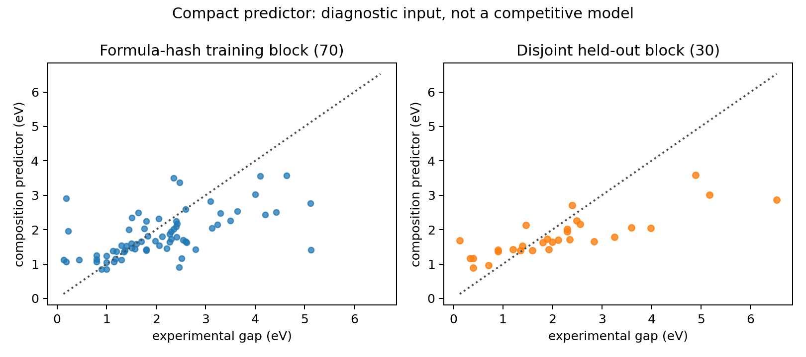
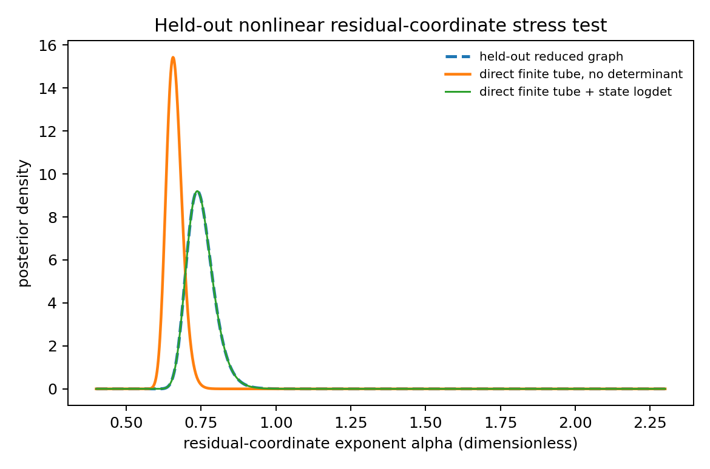

# Matbench band gaps: a nonlinear-coordinate stress test

[Examples index](../README.md) ·
[Repository overview](../../README.md) ·
[Technical details](TECHNICAL_DETAILS.md)

This real-data demonstrator shows detcorr recovering the intended held-out graph
target under a nonlinear residual coordinate and deterministic split. Omitting
state volume moves the residual exponent by `-1.923` posterior standard
deviations.

## Problem

One hundred experimental gaps are selected deterministically from the
MIT-licensed Matbench `expt_gap` dataset and then sorted by formula hash.
Seventy fit a compact composition predictor and the remaining thirty alone
enter the posterior likelihood.



*The deterministic formula-hash split keeps the posterior-evaluation gaps out
of the compact predictor fit.*

To keep the nonlinear residual dimensionally meaningful, energies are scaled
by `E0=1 eV`:

```math
e_i=E_i/E_0,
\qquad m_i=M_i/E_0,
\qquad c_i(\alpha,e_i)=e_i^\alpha-m_i.
```

## What detcorr changes

On the solved graph,

```math
e_i=m_i^{1/\alpha},
\qquad D_ec_i=\alpha e_i^{\alpha-1}.
```

Direct finite-penalty quadrature is performed over every held-out state.

| Target | Mean `alpha` | Shift from graph |
|---|---:|---:|
| Reduced graph | 0.750623 | 0 SD |
| Naive finite tube | 0.661859 | -1.923 SD |
| detcorr finite tube | 0.750623 | approximately 0 SD |



*The corrected finite tube follows the held-out graph target, while the naive
nonlinear coordinate shifts the residual-exponent posterior.*

The corrected density has L1 error `3.96e-7` from the graph target. Repeating
the calculation in meV with `E0=1000 meV` reproduces the target to numerical
precision. `L1` is the integrated absolute difference between normalized
density curves.

## Why it matters

Nondimensionalization makes the model independent of the chosen energy unit;
detcorr then prevents the nonlinear residual coordinate from imposing an
additional, unintended posterior preference. In this fixture the correction
is large enough to change the reading of the residual exponent, while the
corrected finite-state calculation agrees with the declared graph target.

## Run

From this directory:

```bash
python -m pip install \
  "detcorr @ git+https://github.com/Olsson-Materials-Modelling/detcorr.git@a414f063515359f70952e2717a506b75e69e4b0b"
python -m pip install -r requirements.txt
python src/bandgap_matbench_detcorr_demo.py \
  --outputs ../../regenerated/matbench-gap
python -m pytest -q
```

## Building on the result

For a materials scientist, the reusable result is the workflow: choose a
dimensionless state, keep predictor fitting separate from held-out evaluation,
declare the target measure, and verify the corrected finite-state target
against the reduced graph calculation. A scientific band-gap study would add a
physically motivated predictor, uncertainty tied to measurement and model
error, representative cross-validation, and external validation. Here
`alpha` parameterises the residual coordinate rather than a material property.

The fixture is a deterministic, non-representative geometry test rather than a
Matbench benchmark fold. Its exact selection, source-file hash, MIT licence,
and rebuild script are recorded in
[`data/FIXTURE_MANIFEST.json`](data/FIXTURE_MANIFEST.json).

[Machine-readable results](outputs/summary.json)
