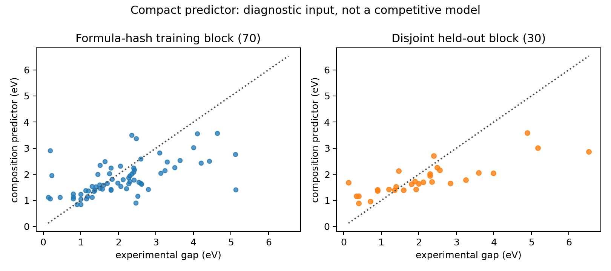
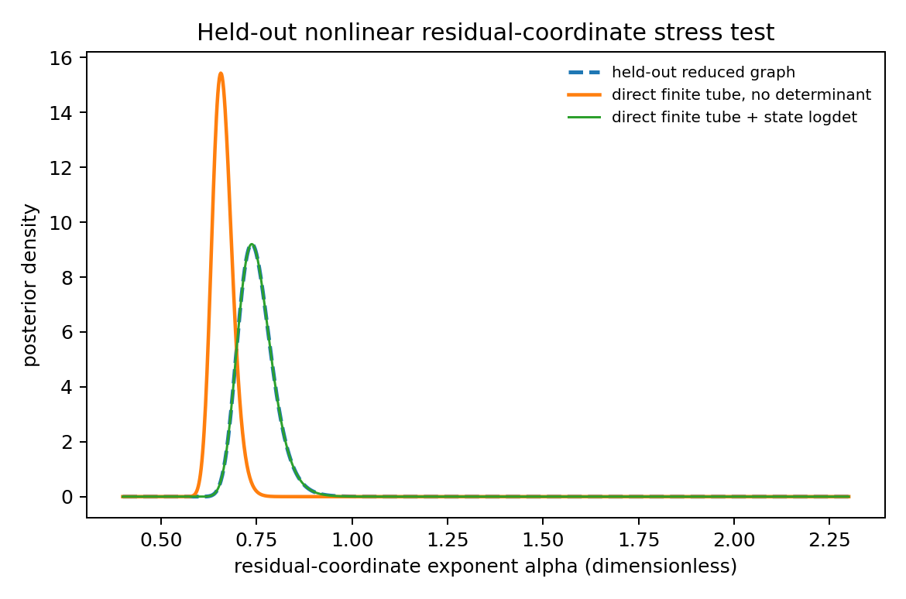
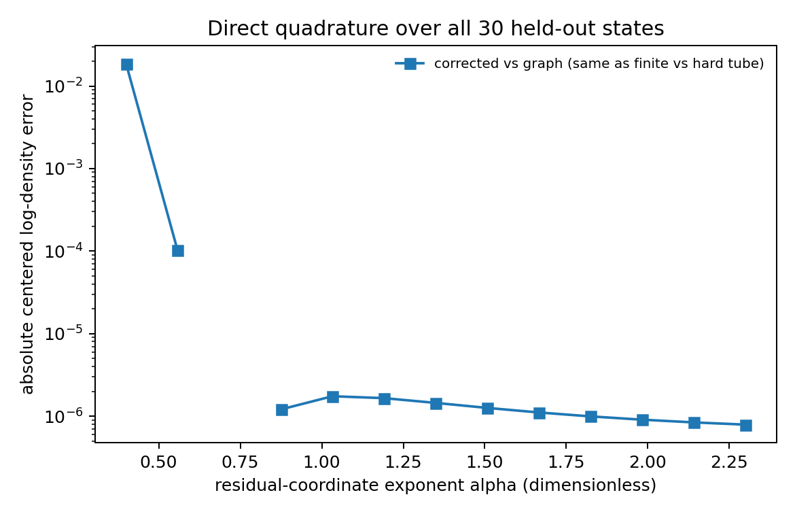

# Technical details: held-out Matbench nonlinear-coordinate stress test

[Back to the example overview](README.md)

This worked example uses 100 experimental inorganic band gaps selected by a
fully deterministic rule from the MIT-licensed Matbench `expt_gap` dataset. It
tests determinant correction for a nonlinear residual coordinate on real data.
The fitted exponent belongs to that coordinate; the example is designed as a
geometry test rather than a band-gap predictor benchmark.

## Problem: make the residual dimensionless and keep evaluation held out

Raising a dimensional energy directly to a variable power is not meaningful:
`E^alpha` changes numerically when eV is replaced by meV. The active example
therefore declares

```text
E0 = 1 eV,
e_i = E_i/E0,
m_i = M_i/E0,
c_i(alpha,e_i) = e_i^alpha - m_i.
```

Both `e_i` and `m_i` are dimensionless. The code repeats the calculation after
expressing every energy in meV with `E0=1000 meV`; graph densities and
determinants agree to machine precision (absolute discrepancies at most
`1e-12`), rather than by an asserted bit-for-bit identity.

The fixture builder scans source rows in their published order and retains the
first 100 unique, finite, strictly positive gaps whose formulas use ordinary
unparenthesized notation. It scans source rows 2 through 193. This fixed
model-eligibility rule uses the declared positive-state support, but no fitted
residual, correction result, or model-performance ranking. It is reproducible
but alphabetically concentrated, so it is not a representative Matbench sample.

The resulting 100 unique formulas are SHA256-hashed and sorted by
`(formula_hash, formula, source_row)`. The first 70 fit a compact composition
predictor; the final 30 are held out and alone enter the posterior likelihood.
This assignment is deterministic and independent of CSV row order.

The predictor is deliberately simple. It fits `log(E/eV + 0.05)` on the 70
training gaps. Its inverse is correctly evaluated as
`exp(prediction) - 0.05` before clipping to the declared range.



The scatter is a warning against overinterpretation: the predictor supplies a
transparent nonlinear constraint input, not competitive Matbench performance.

## Model and determinant correction

For each held-out formula,

```text
c_i(alpha,e_i) = e_i^alpha - m_i = 0,
e_i(alpha) = m_i^(1/alpha),
D_e c_i = alpha e_i^(alpha-1).
```

The declared target is a graph posterior over positive, dimensionless `alpha`
with respect to `d alpha`. The reduced likelihood compares the 30 observed
dimensionless gaps with the solved states. An iid Gaussian discrepancy uses the
training RMSE as a plug-in scale.

The default prior is the lognormal density with respect to `d alpha`:

```text
log(alpha) ~ Normal(0, 0.42^2),
p(alpha) = exp[-(log alpha)^2/(2 * 0.42^2)]
           / (alpha * 0.42 * sqrt(2 pi)),   alpha > 0.
```

The finite-penalty full-space density is relative to
`d alpha product_i de_i`, ordinary Lebesgue measure in the 30 dimensionless
held-out state coordinates. The determinant correction is defined for that
declared `e` coordinate and base measure.

The naive residual tube contains the inverse state-volume factor. The corrected
tube adds the following term **inside the state integral**, evaluated at every
quadrature state rather than only at the solved graph state:

```text
sum_i log |alpha e_i^(alpha-1)|.
```

The public `detcorr` API is checked twice: once with the exact diagonal and once
by differentiating the callable nonlinear residual.

## Independent result

The main naive and corrected curves are not produced by subtracting and
re-adding the reduced target. For every grid value of `alpha`, the script
directly integrates the finite-penalty density over each of the 30 held-out
state coordinates with stable local trapezoid quadrature.



For the pinned fixture, split, prior, grid, and penalty:

- graph mean: `0.750623`, graph SD: `0.046153`;
- naive direct-tube mean: `0.661859`;
- corrected direct-tube mean: `0.750623`;
- naive-minus-corrected shift: `-1.923` graph SD;
- naive density L1 difference from graph: `1.592`;
- corrected density L1 error: `3.96e-7`.



At 13 representative exponent values, an 801-point-per-state validation pass
has a worst centered log-density discrepancy of `0.0186`. The normalized
posterior agreement is substantially tighter because the largest asymptotic
errors occur away from the posterior mass.

The state integral is explicitly local and window-limited: each interval spans
`+/-9` linearized penalty standard deviations about its solved state, not the
entire positive state line. The worst value is at `alpha=0.4`, more than 419
graph log-density units below the posterior peak. Widening the interval to
`+/-12` changes the centered result by less than `3e-13` and does not improve
the `0.0186` discrepancy; doubling `rho` approximately halves it. The reported
extreme-grid discrepancy is therefore dominated by finite-penalty bias, not by
the trapezoid resolution or a materially omitted window tail.

## What the result means

The defensible conclusion is conditional and geometrical: after a fixed
nondimensionalization, the nonlinear state Jacobian materially changes the
held-out `alpha` target if omitted, and direct local quadrature over every
held-out state variable verifies the finite-penalty comparison.

`alpha` is a residual-coordinate exponent. It is not claimed to be an optical,
electronic, compositional, or material property. The example does not estimate
a physical law, establish predictive performance, propagate predictor
uncertainty, or reproduce Matbench cross-validation.

## Run

From this directory, with `detcorr` installed:

```bash
python src/bandgap_matbench_detcorr_demo.py \
  --outputs ../../regenerated/matbench-gap
python -m pytest -q
```

From the repository root:

```bash
python examples/materials_bandgap_matbench/src/bandgap_matbench_detcorr_demo.py \
  --outputs regenerated/matbench-gap
```

The deterministic script accepts `--data`, `--outputs`, `--n-grid`, `--rho`,
and `--n-quad`.

## Provenance and licence boundary

The CSV is SHA256-pinned and its formula-hash split is written to the outputs.
Its direct source is Hacking Materials, *expt_gap* (2019), Figshare dataset DOI
[`10.6084/m9.figshare.9765779.v1`](https://doi.org/10.6084/m9.figshare.9765779.v1).
The authoritative Figshare dataset record declares the dataset under the MIT
licence. The source also belongs to the Matminer `expt_gap` and Matbench v0.1
`matbench_expt_gap` lineage and cites Zhuo, Mansouri Tehrani, and Brgoch,
*Predicting the Band Gaps of Inorganic Solids by Machine Learning*, DOI
`10.1021/acs.jpclett.8b00124`.

The source payload URL, source SHA256 and Figshare MD5, exact selection rule,
fixture byte identity, deterministic split, attribution, and rights basis are
recorded in
[`data/FIXTURE_MANIFEST.json`](data/FIXTURE_MANIFEST.json). The operative reuse
action is consolidated in
[`../../THIRD_PARTY_NOTICES.md`](../../THIRD_PARTY_NOTICES.md).

## Outputs

The public output contract is strict JSON + CSV + PNG only.

- `outputs/summary.json`: strict JSON target, units, split proof, validation,
  checks, limitations, and provenance;
- `outputs/tables/posterior_summaries.csv`: reduced, naive, and corrected
  posterior summaries;
- `outputs/tables/finite_state_quadrature.csv`: independent all-state
  quadrature validation;
- `outputs/tables/formula_hash_split.csv`: complete auditable split;
- `outputs/tables/heldout_states.csv`: the 30 held-out observations and
  dimensionless constraint inputs; and
- `outputs/heldout_alpha_posteriors.png`, `outputs/formula_hash_predictor.png`,
  and `outputs/finite_state_quadrature_validation.png`: generated figures.

## Reproduction and evidence record

The run is deterministic. Formula SHA256 hashes define the 70/30 split,
posterior normalization uses grid integration, and the full-space route uses
deterministic state quadrature. No sampler, randomized split or fitted seed is
involved.

The bundled `data/matbench_expt_gap_fixture.csv` SHA256 is:

```text
106f00fc0032a52791d837a7c92614649447cccc12679797ac1a66d5a4e0904c
```

Given the pinned `expt_gap.json.gz` payload, rebuild the fixture with:

```bash
python data/build_fixture.py \
  --source /path/to/expt_gap.json.gz \
  --output /tmp/matbench_expt_gap_fixture.csv
```

The builder verifies the source payload SHA256 before applying the declared
selection and produces the fixture hash above.

To regenerate without replacing committed evidence:

```bash
python src/bandgap_matbench_detcorr_demo.py \
  --outputs ../../regenerated/matbench-gap-output
```

The load-bearing calculation directly integrates each of the 30 held-out
states over a local `+/-9` linearized-penalty-SD window. At 13 representative
`alpha` values, the worst centered finite-penalty error is `0.0186` at
`alpha=0.4`, more than 419 graph log-density units below the posterior peak.
Widening the window to `+/-12` changes the centered result by less than `3e-13`;
the remaining extreme-grid error is finite-penalty bias rather than window
truncation.

The fixture source, citation, extraction fields, split, and redistribution
boundary are recorded in `data/FIXTURE_MANIFEST.json` and
`../../THIRD_PARTY_NOTICES.md`; the SHA256 above is enforced by the loader and
tests.
