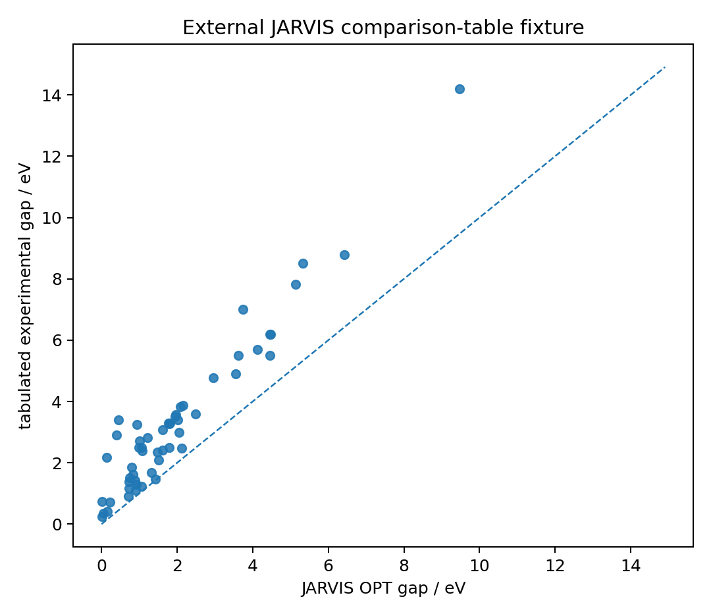
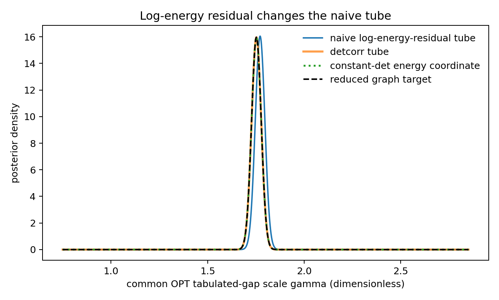

# JARVIS band gaps: a log-energy scale correction

[Examples index](../README.md) ·
[Repository overview](../../README.md) ·
[Technical details](TECHNICAL_DETAILS.md)

This example applies detcorr to a positive-energy calibration using 54 paired
JARVIS optB88-vdW (`OPT`) and tabulated experimental gaps. `detcorr` and a
constant-determinant control recover the same graph target; with a log-energy
residual, omitting volume moves the common scale by `+0.762` posterior standard
deviations.

The positive multiplier is `gamma`. Here **graph target** means the posterior
obtained after solving the positive-energy constraint; it is unrelated to a
graph neural network.

## Problem

The model uses one positive scale,

```math
E_i(\gamma)=\gamma E_i^{\mathrm{OPT}},
```

with a fixed, outcome-independent Gaussian discrepancy model.



*The pinned fixture pairs calculated OPT gaps with the tabulated experimental
values used by the one-scale demonstrator.*

Set `E0=1 eV` and define the positive dimensionless state `e=E/E0`. The active
constraint is

```math
c_i(\gamma,e_i)=
\log\!\left(\frac{e_i}{\gamma E_i^{\mathrm{OPT}}/E_0}\right)=0.
```

## What detcorr changes

On the graph, `|D_e c_i|=1/e_i`. A naive tube therefore acquires a systematic
scale preference; detcorr supplies the missing product of state derivatives.

| Target | Mean `gamma` | SD |
|---|---:|---:|
| Reduced graph | 1.7526 | 0.0250 |
| Naive log-energy tube | 1.7716 | 0.0249 |
| detcorr log-energy tube | 1.7526 | 0.0250 |
| Direct-energy control | 1.7526 | 0.0250 |



*The corrected log-energy tube and direct-energy control follow the same graph
target; the naive log coordinate creates the visible shift.*

Independent global state integration over all positive energies agrees with
the corresponding hard-limit targets to better than `1e-4` in centered log
density.

## Why it matters

When inference integrates a finite residual tube, exact feasibility does not
remove its coordinate-dependent surrounding volume. detcorr makes that
consequence explicit while retaining the intended calibration posterior.

## Run

From this directory:

```bash
python -m pip install \
  "detcorr @ git+https://github.com/Olsson-Materials-Modelling/detcorr.git@a414f063515359f70952e2717a506b75e69e4b0b"
python -m pip install -r requirements.txt
python src/bandgap_samplers_detcorr_demo.py \
  --outputs ../../regenerated/jarvis-band-gaps
python -m pytest -q
```

## Scope and next step

The inferred scale is conditional on this table and demonstrator likelihood.
The linked scientific case study tests its grouped predictive value,
within-fixture nested-threshold sensitivity, and the additional structure
needed for materials use.

[Machine-readable results](outputs/summary.json) ·
[Extended scientific case study](../../case_studies/studies/jarvis_band_gaps/README.md)
