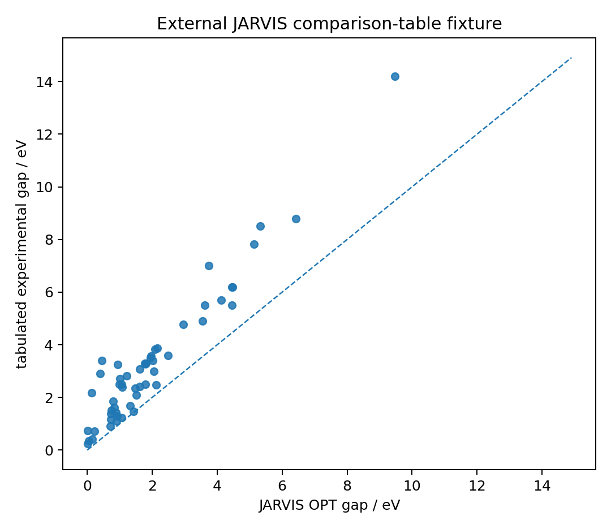
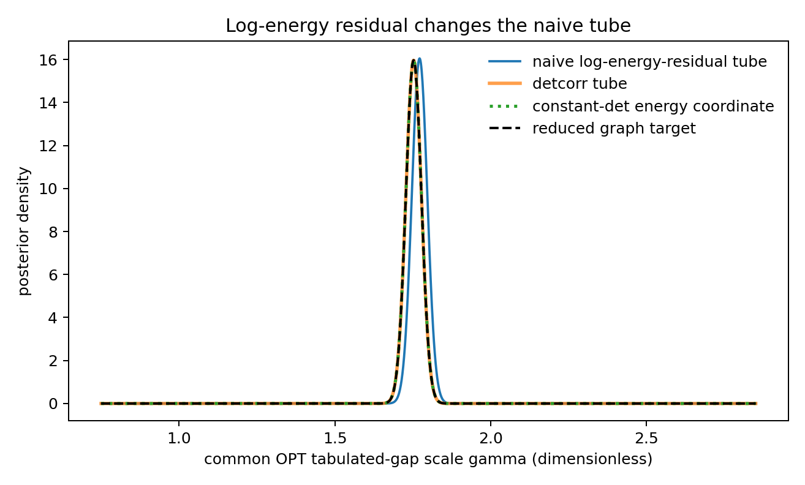

# Technical details: JARVIS tabulated-gap log-energy-residual demonstrator

[Back to the example overview](README.md)

This worked example combines an external JARVIS comparison table with a
deliberately simple common-scale calibration. It demonstrates a determinant
correction on a globally admissible positive-energy tube. It is not a
benchmark-quality band-gap model or a transferable material correction.

## Problem and graph target

The pinned table supplies positive OPT calculated and tabulated experimental
gaps, both in eV. The source page labels the latter only as experimental gaps;
fundamental-versus-optical measurement type is unresolved row by row. The
reduced graph uses

```text
E_i(gamma) = gamma E_i^OPT
E_i^expt | gamma ~ Normal(gamma E_i^OPT, sigma_i^2)
sigma_i = sqrt((0.15 E_i^OPT)^2 + (0.12 eV)^2)
log(gamma) ~ Normal(0, 0.62^2), density with respect to d gamma.
```

The fixed, outcome-independent uncertainty is an explicit demonstrator
assumption. It is determined from the OPT input before evaluating the
experimental response and aggregates measurement and model discrepancy; it is
not a sourced experimental error law.



## Active constraint and measure

Set `E0=1 eV` and use the positive dimensionless physical state `e_i=E_i/E0`
under the base measure

```text
d gamma product_i de_i.
```

The active residual is

```text
c_i(gamma,e_i) = log(e_i/(gamma E_i^OPT/E0)) = 0.
```

On the graph,

```text
e_i = gamma E_i^OPT/E0
|D_e c_i| = 1/e_i = 1/(gamma E_i^OPT/E0).
```

A naïve hard tube therefore acquires `1/|det D_e c|`, shifting its posterior
upward in `gamma`. Multiplying by the declared correction `|det D_e c|`
recovers the graph target. The direct residual `e_i-gamma E_i^OPT/E0` has
constant state Jacobian and is the control.

More generally, if a state base density is `q`, the graph multiplier is `J/q`,
not automatically `J`. Here `q=1`, so the active multiplier is `J=1/e`.
Under a genuine coordinate pushforward both `J` and `q` transform and their
ratio is invariant; carrying a pushed `q` and multiplying by the transformed
`J` again would double-count the coordinate change.

For the pinned fixture, the deterministic grid gives approximately:

| Target | Mean `gamma` | SD |
|---|---:|---:|
| Reduced graph | 1.7526 | 0.0250 |
| Naïve log-energy tube | 1.7716 | 0.0249 |
| Determinant-corrected tube | 1.7526 | 0.0250 |
| Constant-determinant direct-energy control | 1.7526 | 0.0250 |

The naïve displacement is about `+0.762` graph SD. This is a declared
state-volume effect, not evidence for either value as a universal physical
correction.



## Global support and independent finite-tube validation

The display grid is not used to assume away remote modes. Both active targets
are normalized in `z=log(gamma)` on `[-120,20]`, including the `+z` Jacobian
needed to transform a density with respect to `d gamma`. Endpoint log drops,
one-percent edge masses, modes and omitted display-grid mass are recorded in
`global_log_gamma_support_audit.csv`. The audit confirms that the compact plot
contains essentially all active graph and naïve mass.

For each material, the naïve finite tube is integrated globally over `e>0`:

```text
integral exp[-0.5((E_expt/E0-e)/(sigma/E0))^2
             -0.5 rho log(e/(gamma E_OPT/E0))^2] de.
```

With `t=log(e/(gamma E_OPT/E0))`, Gauss--Hermite quadrature covers the complete
positive state domain. The corrected finite tube is a genuinely separate
integral with the state-dependent `1/e` multiplier inside the integrand; in
`t` coordinates it cancels the `de=e dt` factor. It is not produced by adding
the graph-state determinant after integrating the naïve tube.

At the committed `rho=3e9`, both the directly integrated naïve tube versus its
hard limit and the independently integrated corrected tube versus the graph
agree to better than `1e-4` in centered log density. The exact values and node
count are recorded in `finite_penalty_tube_validation.csv`.

## Rejected reciprocal construction

The rejected residual

```text
u=E0/E,
c=1/u-gamma E_OPT/E0
```

under separately declared Lebesgue `du` is not an admissible finite-tube
example. As `u` tends to infinity, its likelihood and penalty factors approach
a strictly positive constant, so the state integral diverges. Its formal naïve
hard-limit density is audited on the same broad `z` support and, under
the corrected outcome-independent likelihood, has negligible mass outside the
display range. That hard-limit fact does not rescue the divergent finite tube.
The repository records both the proof and global calculation in
`rejected_reciprocal_construction.csv`. It does not truncate, normalize, or
sample the rejected finite-penalty construction.

## Sampler and optimizer roles

Random-walk Metropolis and SMC sample only the active reduced graph and active
naïve log-energy hard-limit targets. There is no duplicate corrected sampler:
after correct reduction it is the graph target. MCMC reports acceptance and a
single-chain autocorrelation ESS. SMC reports weight ESS, resampling and final
particle diversity, not a time-series ESS for unordered particles.

The alternating augmented-Lagrangian calculation is a fixed-iteration
constrained-MAP feasibility check in the direct energy coordinate. It is an
optimizer, not a posterior sampler or independent determinant validation.

## Domain sensitivity and scientific limits

All 54 finite positive pairs enter the main target. Thresholds of 0, 0.2, 0.5
and 1.0 eV are reported as explicit sensitivity analyses; none is silently
used to select the main result.

- The common scale is conditional on this table, prior, fixed likelihood,
  row-independence assumption and one-parameter model.
- Repeated formulas or sources may be correlated.
- Temperature, structure-specific error and measurement protocol are not
  modeled.
- The exact fixture values are adapted from CC BY 4.0 Scientific Data Table 3;
  retain the attribution, licence, change, qualification, and non-endorsement
  notice in the repository's third-party-data record.

## Run

```bash
python src/bandgap_samplers_detcorr_demo.py \
  --outputs ../../regenerated/jarvis-band-gaps
pytest -q
```

The complete reproduction instructions and evidence map are consolidated
below.

## Reproduction and evidence record

Install the local dependencies and run the committed calculation from this
directory:

```bash
python -m pip install -r requirements.txt
python src/bandgap_samplers_detcorr_demo.py \
  --outputs ../../regenerated/jarvis-band-gaps
python -m pytest -q
```

For a faster separately written smoke run:

```bash
python src/bandgap_samplers_detcorr_demo.py \
  --outputs ../../regenerated/detcorr-jarvis-gap-smoke \
  --n-grid 600 \
  --validation-points 7 \
  --validation-nodes 96 \
  --mcmc-steps 2200 \
  --mcmc-burn 400 \
  --smc-particles 800 \
  --smc-temper-steps 10 \
  --smc-move-steps 1 \
  --augmented-lagrangian-iters 100
```

The bundled `data/jarvis_bandgap_benchmark_fixture.csv` SHA256 is:

```text
4b7a5f437b1a41030bb65c31d56eaa9524cc91598bd09ff2825c02df60528631
```

The loader verifies this hash unconditionally. The primary grid and finite-state
integrals are deterministic. MCMC and SMC are seeded diagnostic checks of only
the graph and deliberately naive hard-limit targets; the corrected result is
not defined by a duplicated sampler branch.

The load-bearing validation performs global Gauss--Hermite integration in the
log-energy residual over all 54 positive states. At `rho=3e9`, its centered
finite-versus-hard error is `6.28e-5` and its independently corrected
finite-versus-graph error is `6.39e-5`. The public diagonal detcorr route agrees
exactly with the analytic state log determinant `-38.63013928243784` at the
audited parameter value.

Principal evidence:

- `outputs/summary.json` — strict target, outcomes, checks and provenance;
- `outputs/tables/finite_penalty_tube_validation.csv` — independent state integration;
- `outputs/tables/global_log_gamma_support_audit.csv` — broad-support normalization;
- `outputs/tables/rejected_reciprocal_construction.csv` — divergence record;
- `outputs/tables/mcmc_smc_sampler_summaries.csv` and
  `smc_tempering_diagnostics.csv` — sampler diagnostics;
- `outputs/tables/alternating_augmented_lagrangian_map_trace.csv` — optimizer trace.

The public output contract is strict JSON + CSV + PNG only. The remaining CSV
tables contain the graph/naive hard targets, external fixture, and fixed-domain
sensitivity. The PNG surface comprises the two figures embedded in the
overview plus `outputs/domain_threshold_sensitivity.png`,
`outputs/mcmc_smc_gamma_check.png`, and
`outputs/alternating_augmented_lagrangian_gamma_trace.png`. `summary.json` is
strict JSON: unavailable diagnostics are `null`, never `NaN`.

The fixture manifest pins the source URL, verification record and licence
boundary. The expanded scientific analysis is
[the JARVIS band-gap case study](../../case_studies/studies/jarvis_band_gaps/README.md).

The source is the
[JARVIS-DB band-gap comparison table](https://jarvis-materials-design.github.io/dbdocs/jarvisdft/),
verified on 2026-07-11. The page labels the dependent column as experimental
but does not resolve fundamental versus optical gap type row by row. The exact
values are adapted from Choudhary *et al.*, *Scientific Data* 5, 180082 (2018),
Table 3, under CC BY 4.0. Required attribution and transformation notices are
in [the repository data record](../../THIRD_PARTY_NOTICES.md).
