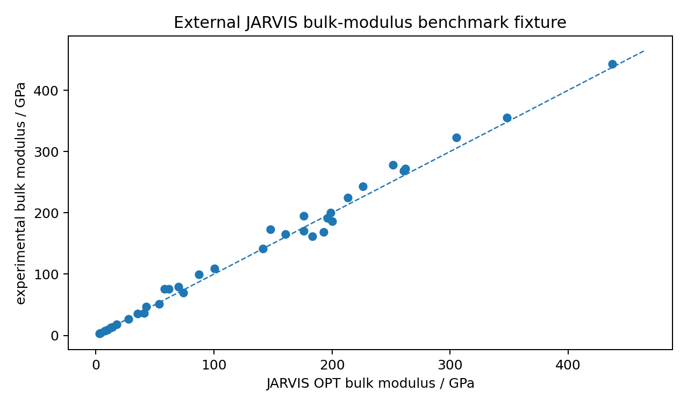
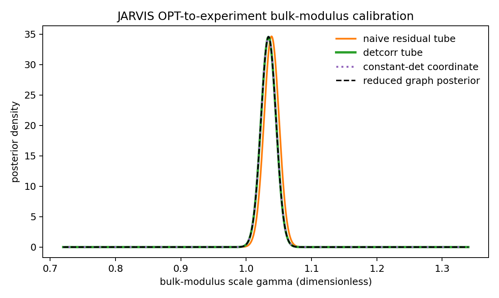

# JARVIS bulk moduli: common-scale calibration

[Examples index](../README.md) ·
[Repository overview](../../README.md) ·
[Technical details](TECHNICAL_DETAILS.md)

This real-data demonstrator uses 36 paired JARVIS optB88-vdW (`OPT`) and
experimental bulk moduli. The corrected and constant-determinant routes recover
the intended graph posterior; omitting volume produces a modest but resolved
shift of `+0.400` posterior standard deviations relative to the corrected
target.

`gamma` is the positive common scale. Here **graph target** means the posterior
obtained after solving the bulk-modulus constraint; it is unrelated to a graph
neural network.

## Problem

The model asks whether one positive scale can calibrate the OPT values:

```math
B_i(\gamma)=\gamma B_i^{\mathrm{OPT}}.
```

The data remain visibly material-specific, making the limited role of this
single calibration parameter clear.



*The paired values are strongly associated but retain material-specific
variation that one common scale cannot describe.*

The active residual is

```math
c_i(\gamma,B_i)=B_i/\gamma-B_i^{\mathrm{OPT}},
\qquad D_Bc_i=1/\gamma.
```

## What detcorr changes

Repeating `1/gamma` across 36 latent states creates a parameter-dependent tube
volume. The direct residual `B_i-gamma B_i^OPT` has constant state determinant
and supplies a coordinate control.

| Target | Mean `gamma` | SD |
|---|---:|---:|
| Reduced graph | 1.0342 | 0.0115 |
| Naive bulk-modulus tube | 1.0389 | 0.0115 |
| detcorr tube | 1.0342 | 0.0115 |
| Direct-residual control | 1.0342 | 0.0115 |



*The detcorr and direct-residual routes follow the same graph target; the naive
repeated-state construction produces the modest visible shift.*

An independent exact Gaussian integration over every latent modulus agrees
with the hard-tube shape to `6.80e-6` in centered log density.

## Why it matters

Even when the numerical shift is moderate, the residual representation can
silently redefine the inferential target. detcorr exposes and removes that
state-volume dependence.

## Run

From this directory:

```bash
python -m pip install \
  "detcorr @ git+https://github.com/Olsson-Materials-Modelling/detcorr.git@a414f063515359f70952e2717a506b75e69e4b0b"
python -m pip install -r requirements.txt
python src/bulk_modulus_samplers_detcorr_demo.py \
  --outputs ../../regenerated/jarvis-bulk-modulus
python -m pytest -q
```

## Scope and next step

This one-parameter calibration quantifies the geometry on the pinned fixture.
The linked scientific case study tests whether the scale improves grouped
prediction and identifies the evidence needed for broader materials use.

[Machine-readable results](outputs/summary.json) ·
[Extended scientific case study](../../case_studies/studies/jarvis_bulk_modulus/README.md)
