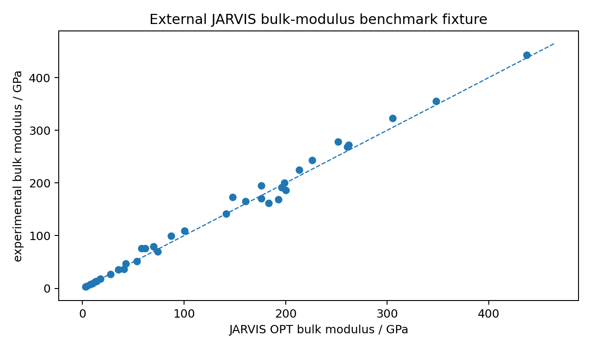
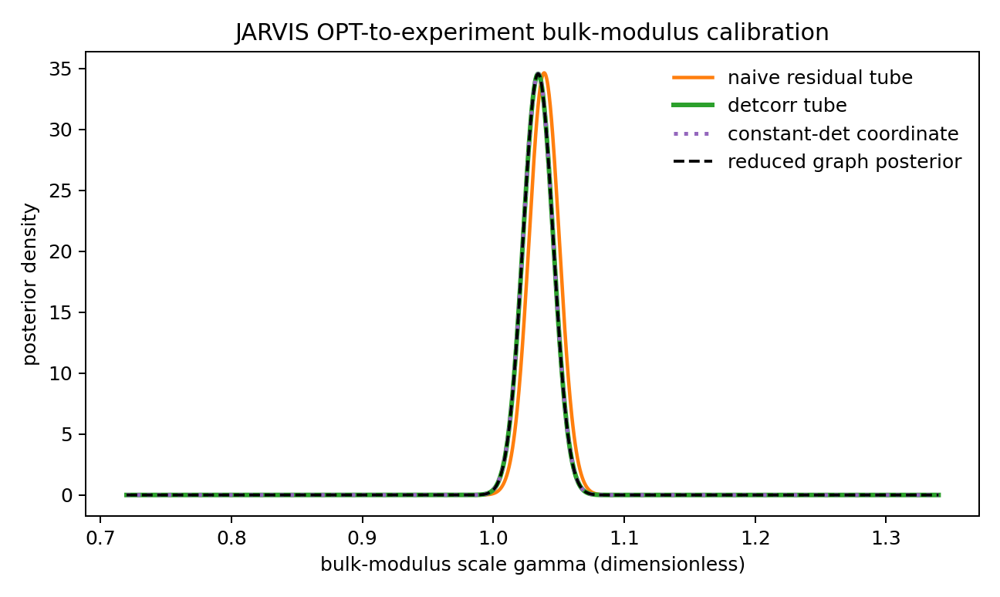

# Technical details: JARVIS bulk-modulus scale demonstrator

[Back to the example overview](README.md)

This external-data demonstrator uses a pinned excerpt of the publicly
accessible JARVIS-DB table comparing optB88-vdW (`OPT`) and experimental bulk
moduli. Both columns are external inputs: the demonstrator
does not generate the experimental response, train a predictor, or hide a
synthetic value of the inferred scale. The 36-row fixture recomputes an OPT vs
experiment MAE of 8.5056 GPa, which rounds to the 8.51 GPa printed with the
source table and provides an aggregate transcription check in addition to the
pinned file hash.

The scientific model is intentionally modest. It asks whether one common
positive factor can calibrate the OPT values to the experimental values while
making the residual-coordinate measure explicit.
The reduced target is a graph posterior with respect to \(d\gamma\).

## Problem

For each material,

```text
B_i(gamma) = gamma B_i^OPT,
```

where `gamma` is a global scale and `B_i` is the latent calibrated modulus. The
fixture is close to the one-to-one line, while its material-specific scatter
also makes clear what the one-parameter model cannot capture.

The default prior is the lognormal density with respect to `d gamma`:

```text
log(gamma) ~ Normal(0, 0.24^2),
p(gamma) = exp[-(log gamma)^2/(2 * 0.24^2)]
           / (gamma * 0.24 * sqrt(2 pi)),   gamma > 0.
```

Accordingly, the reduced graph target is a density relative to `d gamma`. The
finite-penalty full-space density is relative to
`d gamma product_i dB_i`, with each numerical `B_i` coordinate expressed in
GPa. The residual metric and `rho` units stated below are part of this measure
contract; changing units requires transforming them consistently.



## Constraint and detcorr solution

The nonconstant-determinant residual is

```text
c_i(gamma, B_i) = B_i/gamma - B_i^OPT = 0
B_i(gamma) = gamma B_i^OPT
D_B c_i = 1/gamma.
```

A naive narrow tube therefore contributes a `gamma`-dependent state-volume
factor. The graph correction adds `log |det D_B c|` and recovers the intended
posterior on the solved constraint graph. The equivalent residual

```text
c'_i(gamma, B_i) = B_i - gamma B_i^OPT = 0
D_B c'_i = 1
```

has constant determinant and is the coordinate control.

## Outcome

For the bundled fixture and uncertainty model, the deterministic grid gives

| Target | Posterior mean of `gamma` | Posterior SD |
|---|---:|---:|
| Reduced graph | 1.0342 | 0.0115 |
| Naive bulk-modulus tube | 1.0389 | 0.0115 |
| Hard-limit determinant-corrected tube | 1.0342 | 0.0115 |
| Solved, constant-determinant coordinate | 1.0342 | 0.0115 |



The determinant effect is modest but resolved by the calculation. The
hard-limit corrected curve is the algebraic round trip `graph - logdet +
logdet`; its `2.41e-19` L1 distance from the graph is floating-point consistency,
not independent validation. The load-bearing check instead integrates the
finite tube over every latent `B_i` in a cancellation-resistant exact Gaussian
product, also checked against direct scalar quadrature. At the committed
`rho=1e6 GPa^-2`, that independently evaluated tube agrees with the coarea
hard-tube shape to `6.80e-6` in centered log density. Adding the same analytic
determinant to that finite integral and comparing with the graph is a useful
consistency view, but not a second independent check.

The residual-scaling table and figure are explicitly hard-limit checks. At
finite penalty, equivalent residual coordinates also require the residual
metric to be transformed consistently; the hard-limit identity alone does not
establish finite-penalty invariance.

## What the samplers demonstrate

The script compares two explicitly named scalar targets with their deterministic
grid references:

- random-walk Metropolis in `log(gamma)` samples the reduced graph posterior and
  the deliberately naive hard-tube posterior;
- SMC likelihood tempering samples the same two targets.

There is intentionally no sampler branch called `corrected`. The corrected-tube
equality belongs to the deterministic hard-limit calculation and the independent
finite-penalty integration above. A genuine sampler-level correction example
would need to sample the joint `(gamma, B)` space and evaluate the correction in
that full-space target.

MCMC acceptance and autocorrelation ESS are single-chain indicators; no
split-R-hat is available. SMC reports the valid final weight ESS, the number and
fraction of distinct particles surviving final resampling, the resampling count,
and move acceptance. It does not compute autocorrelation ESS from the arbitrarily
ordered resampled particles.

For comparison, the script also runs a fixed-iteration alternating
augmented-Lagrangian constrained-MAP calculation. This is accurately treated as
a block-coordinate optimization/feasibility heuristic, not posterior sampling.
Its trace reports constraint feasibility, gamma-step size, and
bounded-subproblem success separately from sampler diagnostics.

## Physical and statistical limits

The dimensional contract is explicit: `gamma` is dimensionless; all bulk
moduli, latent states, residuals, and uncertainty scales are in GPa. Therefore
the finite-penalty and augmented-Lagrangian values called `rho` have units
`GPa^-2`, making each `rho * c^2` term dimensionless. Changing the modulus unit
requires the corresponding inverse-square rescaling of `rho` and the numerical
uncertainty parameters.

The fixed outcome-independent demonstrator discrepancy scale

```text
sigma_B = sqrt((0.055 B_OPT)^2 + (3 GPa)^2)
```

is determined from the OPT reference input before the experimental response is
evaluated. It is an explicit, ad hoc demonstrator choice that bundles
experimental scatter and material-specific functional error, not a validated
uncertainty model. A physical application should show sensitivity to the
fractional and floor terms.

The 36-row table is distributed under NIST's public-information permission,
with attribution, transformation, disclaimer, and non-endorsement notices
retained. It is not placed under the repository MIT licence or relabelled as
CC BY. See [the repository data record](../../THIRD_PARTY_NOTICES.md).

The JARVIS experimental comparison values are reported without zero-point
energy correction. Temperature, phase, measurement protocol, and
material-specific functional errors are also not modeled. Accordingly,
`gamma` is a calibration summary for this fixture, not a universal correction
to DFT bulk moduli.

## Run

```bash
python src/bulk_modulus_samplers_detcorr_demo.py \
  --outputs ../../regenerated/jarvis-bulk-modulus
python -m pytest -q
```

For a larger run:

```bash
python src/bulk_modulus_samplers_detcorr_demo.py \
  --outputs ../../regenerated/jarvis-bulk-modulus-large \
  --mcmc-steps 50000 \
  --mcmc-burn 5000 \
  --smc-particles 20000 \
  --smc-temper-steps 48 \
  --smc-move-steps 4 \
  --augmented-lagrangian-iters 120
```

The public output contract is strict JSON + CSV + PNG only. Machine-readable
results are written to `outputs/summary.json` and CSV tables under
`outputs/tables/`; figures are written as PNG.

## Reproduction and evidence record

The bundled `data/jarvis_bulk_modulus_benchmark_fixture.csv` SHA256 is:

```text
6d9c37c52ef1d7eeb62d0cce3bc00f5b4c979b4b5d2b3bdcfcda8ab6a73cae86
```

The loader verifies this hash unconditionally. The 36-row OPT-versus-experiment MAE
is `8.5056 GPa`, reproducing the source table's rounded `8.51 GPa` aggregate
and providing a second transcription check.

The load-bearing validation evaluates an exact cancellation-resistant product
of scalar Gaussian state integrals, independently of the graph-minus-logdet
hard-limit rows. At `rho=1e6 GPa^-2`, its centered finite-versus-hard error is
`6.80e-6`. The detcorr API agrees exactly with the analytic state log
determinant `-0.7920238014586898` at the audited parameter value.

Principal evidence:

- `outputs/summary.json` — strict model, outcomes, diagnostics and provenance;
- `outputs/tables/main_hard_limit_posteriors.csv` — graph, naive and controls;
- `outputs/tables/finite_penalty_tube_validation.csv` — independent state integral;
- `outputs/tables/mcmc_smc_sampler_summaries.csv` and
  `smc_tempering_diagnostics.csv` — sampler diagnostics;
- `outputs/tables/alternating_augmented_lagrangian_map_trace.csv` — optimizer trace.

The fixture manifest records source, hash and redistribution boundary. The
expanded scientific analysis is
[the JARVIS bulk-modulus case study](../../case_studies/studies/jarvis_bulk_modulus/README.md).

The source is the
[JARVIS-DB bulk-modulus comparison table](https://jarvis-materials-design.github.io/dbdocs/jarvisdft/),
verified on 2026-07-11. The source notes that its experimental comparison values
are not corrected for zero-point energy. The NIST public-information basis,
disclaimer, and reuse action are recorded in
[the repository data record](../../THIRD_PARTY_NOTICES.md).
