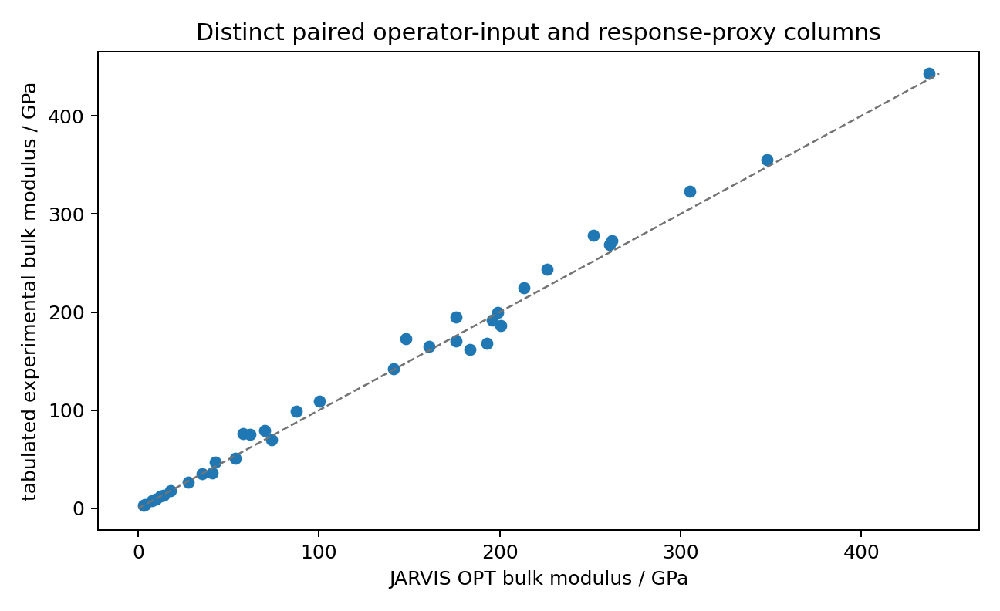
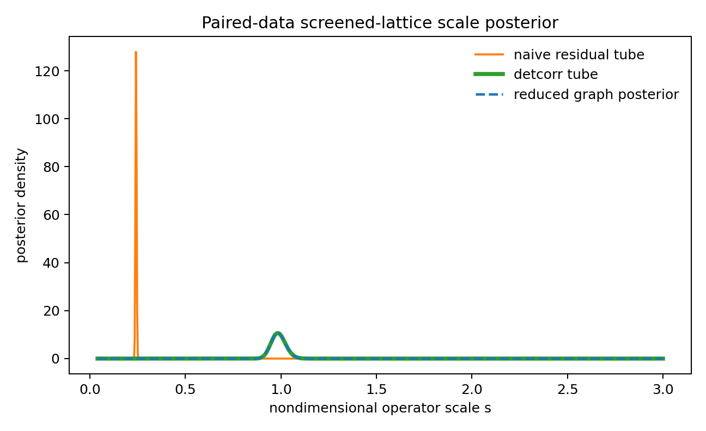
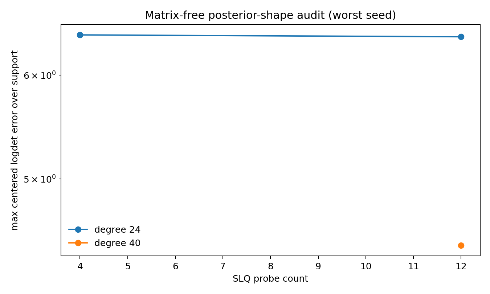

# Screened lattice: a high-dimensional determinant stress test

[Examples index](../README.md) ·
[Repository overview](../../README.md) ·
[Technical details](TECHNICAL_DETAILS.md)

This example combines paired JARVIS bulk-modulus inputs with an illustrative
4,500-state sparse network. The exact determinant correction recovers the graph
target and shows that state-volume terms can accumulate when a contribution is
repeated across this construction: omission moves the inferred scale by
`-19.74` posterior standard deviations.

`OPT` denotes optB88-vdW calculations. Here **graph target** means the posterior
obtained after solving the sparse network state; it is unrelated to a graph
neural network.

## Problem

For each of 36 materials, OPT values set operator coefficients and the distinct
experimental column sets a response proxy. The constrained scalar state is

```math
c_j(s,u_j)=A_j(s)u_j-f=0,
\qquad A_j(s)=\mathrm{pin}\,I+s k_jL_d.
```

All quantities are nondimensional. The operator is a sparse screened-Poisson
network in two or three dimensions.



*OPT values set illustrative operator coefficients and the separate
experimental column sets the response proxy.*

## What detcorr changes

A naive full-state tube contains

```math
\prod_j |\det A_j(s)|^{-1}.
```

The determinant is evaluated exactly from the separable spectrum and checked
against sparse LU.

| Target | Mean `s` | SD |
|---|---:|---:|
| Reduced graph | 0.9871 | 0.0378 |
| Naive residual tube | 0.2415 | 0.0031 |
| detcorr tube | 0.9871 | 0.0378 |



*Across 4,500 states, the omitted volume accumulates into a large naive shift;
the exact determinant correction follows the solved-network target.*

Exact Gaussian integration over all 4,500 states verifies the finite-tube
shape to `4.00e-3` in centered log density.

## Matrix-free lesson

The exact spectral calculation remains the inference route. The bundled
Gram-matrix stochastic Lanczos quadrature (`SLQ`) settings retain `4.45–6.44`
log-unit centered errors over posterior support and provide an explicit
approximation diagnostic.



*The committed matrix-free settings do not yet reproduce the exact centered
log determinant closely enough to replace the spectral route.*

## Why it matters

High-dimensional constructions can amplify state-volume terms, while
approximate log-determinants can introduce a second posterior-shape error. Both
effects must be measured over the parameter region that carries probability
mass.

## Run

From this directory:

```bash
python -m pip install \
  "detcorr @ git+https://github.com/Olsson-Materials-Modelling/detcorr.git@a414f063515359f70952e2717a506b75e69e4b0b"
python -m pip install -r requirements.txt
python src/screened_lattice_2d3d_jarvis_detcorr_demo.py \
  --outputs ../../regenerated/screened-lattice
python -m pytest -q
```

## Scope and next step

This scalar screened-network example is a high-dimensional sparse-determinant
and approximation-audit demonstrator. A physical lattice application would add
the relevant constitutive model, units, boundary conditions, and observations.

[Machine-readable results](outputs/summary.json)
