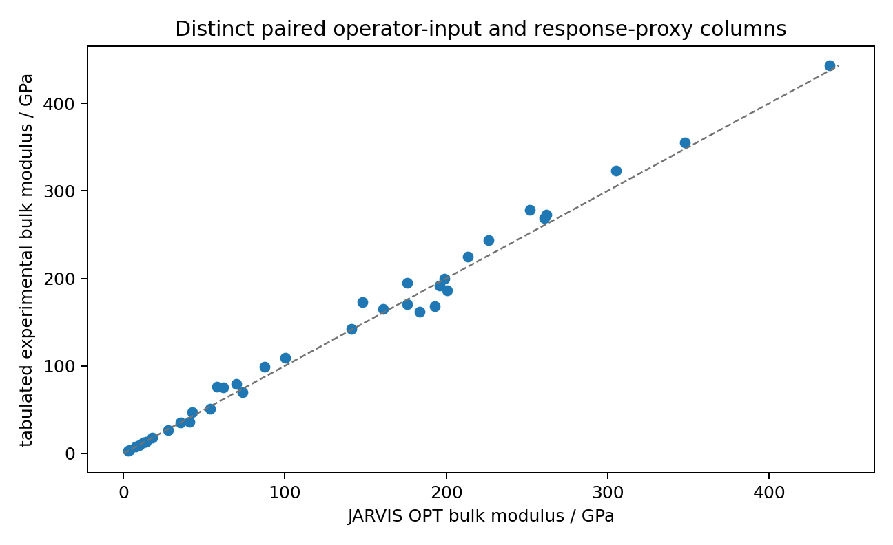
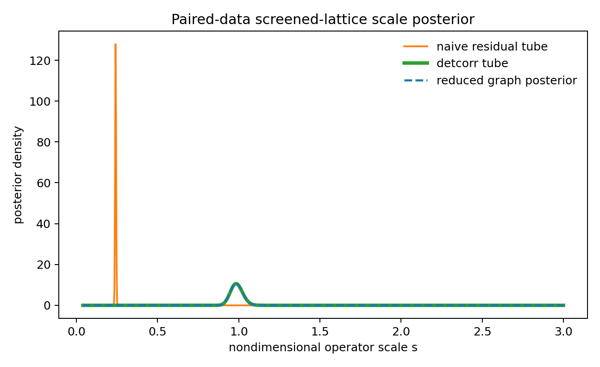
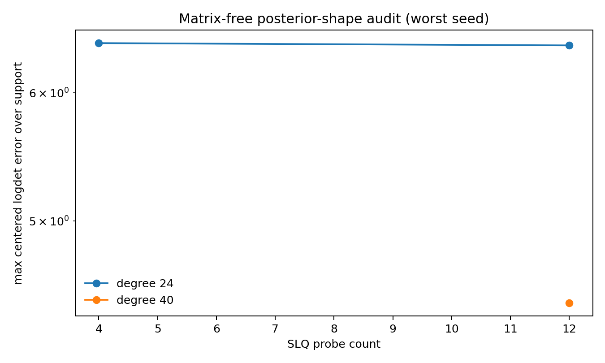

# Technical details: paired-JARVIS screened-lattice determinant demonstrator

[Back to the example overview](README.md)

This example combines real paired JARVIS bulk-modulus values with an
illustrative high-dimensional state model. It is a **nondimensional scalar
screened-Poisson network**, not an elasticity calculation. Its purpose is to
show how a sparse state determinant can dominate a residual-tube posterior and
how to test a matrix-free approximation against exact references.

## Problem

The pinned JARVIS comparison table contains two distinct external columns for
36 materials:

- optB88-vdW (`OPT`) bulk moduli, used only to set operator coefficients;
- tabulated experimental bulk moduli, used only to set the response proxy.

For material `j`, the constrained scalar grid state is

```text
c_j(s,u_j) = A_j(s)u_j - f = 0,
A_j(s) = pin I + s k_j L_d,
k_j = B_j^OPT / median(B^OPT),       d in {2,3}.
```

`L_d` is a Kronecker-sum graph Laplacian on a fixed nondimensional Dirichlet
grid. The load `f`, scalar state `u_j`, residual and operator are all
nondimensional. No lattice spacing, displacement vector, shear modulus or
elastic tensor is implied.

The experimental column supplies a separate reciprocal proxy:

```text
y_j = g_ref median(B^expt) / B_j^expt,
```

where `g_ref` is the model's point-to-point Green response at `s=1` and
`k=1`. This normalization is fixed before inference and maps the external
reciprocal-modulus ratios to the state-response coordinate. Because both the
reference response and operator coefficients are anchored at unit scale, a
posterior near `s=1` is partly a normalization convention rather than a
discovered materials scale.



The Gaussian scale is also fixed in advance:

```text
sigma_j / g_ref = sqrt[(0.18 y_j/g_ref)^2 + 0.04^2].
```

It is a response-scaled generalized Gaussian loss for the demonstrator target,
not a normalized generative likelihood or a reported experimental uncertainty.
It defines a transparent simplified target; it does not turn the scalar network
into a validated materials model.

## Why determinant correction is required

The reduced target is the posterior over `s` with respect to `ds`, after solving
`u_j=A_j(s)^{-1}f`. A narrow full-state residual penalty has a state-volume
factor

```text
prod_j |det A_j(s)|^-1.
```

Consequently,

```text
log pi_naive(s)     = log pi_graph(s) - sum_j log|det A_j(s)|,
log pi_detcorr(s)   = log pi_naive(s) + sum_j log|det A_j(s)|.
```

The default prior is a lognormal density with respect to `ds`:

```text
log(s) ~ Normal(0, 0.32^2),
p(s) = exp[-(log s)^2/(2 * 0.32^2)]
       / (s * 0.32 * sqrt(2 pi)),   s > 0.
```

The full-space finite-penalty density is relative to
`ds product_j d^(n_grid^d)u_j`: ordinary Lebesgue measure in all 4,500
dimensionless scalar state coordinates for the committed run. The determinant
correction is tied to this declared state coordinate and base measure.

The main correction is evaluated from the separable spectrum. Exact sparse LU
cross-checks 2D and 3D audit grids. The corrected-equals-graph identity is not
the only test: the code separately evaluates the finite-penalty Gaussian
integral over all 4,500 scalar state variables.

## Posterior outcome



For the committed 3D `5 x 5 x 5` run:

| Target | Mean `s` | SD | L1 distance from graph |
|---|---:|---:|---:|
| Reduced graph | 0.9871 | 0.0378 | 0 |
| Naive residual tube | 0.2415 | 0.0031 | 2.0000 |
| Determinant-corrected tube | 0.9871 | 0.0378 | `2.13e-13` |

The `2.13e-13` entry is the algebraic hard-limit round trip `graph - logdet +
logdet`; it records floating-point consistency and is not an independent
validation error.

The naive-minus-corrected mean displacement is `-19.74` graph standard
deviations. This is intentionally an extreme high-state-dimension case. It
demonstrates state-volume accumulation; it is not a physical estimate of a
materials correction.

The widened grid covers all three targets: every mode is interior and the
largest committed two-percent edge mass is below `2.2e-82`. Thus the naive
summary is no longer an artifact of the lower grid boundary.

Across the union of the central 98% graph and naive posterior supports, the
independent finite-penalty calculation agrees with the hard-tube shape to
`4.00e-3` in centered log density; adding the exact state log determinant
agrees with the reduced graph shape to `3.73e-3`. The committed validation uses
`rho=5e10` and integrates all 4,500 state coordinates exactly as a sparse
multivariate Gaussian. The `4.00e-3` finite-versus-hard result is the
load-bearing independent check. The `3.73e-3` corrected-versus-graph row
re-adds that same exact determinant and is therefore a consistency view, not a
second independent calculation.

## Matrix-free outcome



The stochastic audit reuses the same random probe stream at the graph `q05`,
mode and `q95`, and repeats the experiment with two seeds. This evaluates the
centered quantity that changes posterior shape, rather than judging an
irrelevant constant log-determinant offset. The Gram construction also squares
the condition number, `kappa(A^T A)=kappa(A)^2`, so apparently moderate
conditioning in `A` can be materially harder for Lanczos quadrature.

The committed settings are **not accurate enough to replace the exact
correction**:

- 4 probes, degree 24: worst centered error `6.44` log units;
- 12 probes, degree 24: worst centered error `6.42` log units;
- 12 probes, degree 40: worst centered error `4.45` log units.

Increasing probe count alone does not resolve the bias; increasing Lanczos
degree helps but still leaves a material posterior-shape error. The exact
separable route therefore remains the inference route. Gram/SLQ is shown only
as an estimator-risk diagnostic.

## What is rigorous here

- OPT and experimental response inputs are different external columns; the old
  reciprocal-of-the-same-input circularity has been removed.
- The state, residual, target measure, nondimensionalization and discrepancy
  convention are explicit.
- Exact separable and sparse-LU determinants agree on audit grids.
- Full-state finite-penalty integration provides a computationally independent
  validation route across the union of the central 98% corrected/graph and
  naive posterior supports.
- Posterior grid support is tested rather than inferred from a plot.
- Residual-rescaling rows suppress naive means when their modes hit the lower
  numerical cutoff; only corrected hard-limit invariance is claimed there.
- Matrix-free errors are measured in centered log-determinant variation over
  posterior support, using common random numbers and multiple seeds.
- Strict JSON replaces non-standard `NaN` tokens with `null`.

## Claim boundary

This is a paired external-data **surrogate demonstrator** whose supported scope
is the determinant and estimator comparison below. A physical materials
interpretation would additionally require:

- `u_j` is a scalar network field, not a displacement vector;
- scalar bulk-modulus ratios do not define anisotropic elasticity;
- the graph grid is a fixed discrete model, not a converged physical mesh;
- changing dimension or grid size changes the demonstrator and its determinant;
- the generalized Gaussian discrepancy weights are ad hoc, response-scaled,
  and conditionally factorized across material rows;
- the resulting `s` is neither an elastic constant nor a transferable material
  parameter;
- the original experimental protocols and zero-point corrections are outside
  the pinned fixture.

The same 36-row transcription is distributed under NIST's public-information
permission, with attribution, transformation, disclaimer, and non-endorsement
notices retained. It is not covered by the repository MIT licence. Source,
verification date, hash, and the reuse basis are recorded in
`data/FIXTURE_MANIFEST.json` and
[the repository data record](../../THIRD_PARTY_NOTICES.md).

## Reproduce

From this directory:

```bash
python src/screened_lattice_2d3d_jarvis_detcorr_demo.py \
  --outputs ../../regenerated/screened-lattice
python -m pytest -q
```

Useful CI-sized variant:

```bash
python src/screened_lattice_2d3d_jarvis_detcorr_demo.py \
  --outputs ../../regenerated/screened-lattice-ci \
  --grid-size 4 --audit-grid-2d 5 --audit-grid-3d 4 \
  --stress-grid-3d 4 --slq-probes 2,4 --slq-degrees 8,12
```

The public output contract is strict JSON + CSV + PNG only. Generated records
include:

- `outputs/summary.json` — strict machine-readable result and limitations;
- `outputs/tables/main_hard_limit_posteriors.csv` — the three targets;
- `outputs/tables/grid_support_diagnostics.csv` — boundary-mass checks;
- `outputs/tables/finite_penalty_tube_validation.csv` — independent state
  integration over both corrected/graph and naive posterior support;
- `outputs/tables/exact_vs_matrix_free_audit.csv` — exact and centered SLQ
  diagnostics;
- `outputs/tables/paired_screened_lattice_observations.csv` and
  `outputs/tables/residual_scaling_sensitivity.csv` — declared inputs and
  residual-coordinate checks; and
- the four PNG figures embedded or described in the overview.

## Reproduction and evidence record

The bundled `data/jarvis_bulk_modulus_paired_fixture.csv` SHA256 is:

```text
6d9c37c52ef1d7eeb62d0cce3bc00f5b4c979b4b5d2b3bdcfcda8ab6a73cae86
```

The loader verifies this hash unconditionally. It is the same source-checked
OPT/experimental transcription used by the scalar
bulk-modulus example. The default output is deterministic. Gram/SLQ uses seeds
`731` and `1741`, with common random numbers across `s` within each
configuration; volatile wall-clock timings are excluded from committed output.

The exact separable determinant is checked against sparse LU on audit grids.
The load-bearing finite-penalty route integrates all 4,500 states as a sparse
Gaussian over the union of the central 98% graph and naive supports. Its worst
centered finite-versus-hard error is `0.00399664`; the corrected consistency
view differs from the graph by at most `0.00372708`.

The matrix-free rows are estimator diagnostics only. With the committed probe
and Lanczos settings, the worst centered error is `6.4404` log units, so the
exact separable determinant remains the posterior route.

After regeneration, the release checks require interior modes and negligible
edge mass, sparse-LU agreement, finite-penalty errors within their tested
tolerance, strict JSON with no non-finite tokens, and interpretation of SLQ as
an audit rather than as the correction used for inference.

The fixture manifest records the source URL, verification date, hash and
redistribution boundary.

The source is the
[JARVIS-DB bulk-modulus comparison table](https://jarvis-materials-design.github.io/dbdocs/jarvisdft/),
verified on 2026-07-11. The NIST public-information basis, disclaimer, and
reuse action are recorded in
[the repository data record](../../THIRD_PARTY_NOTICES.md).
