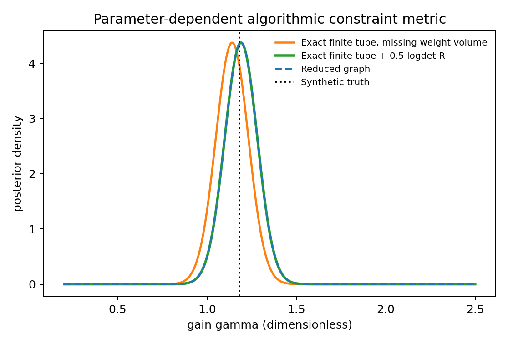
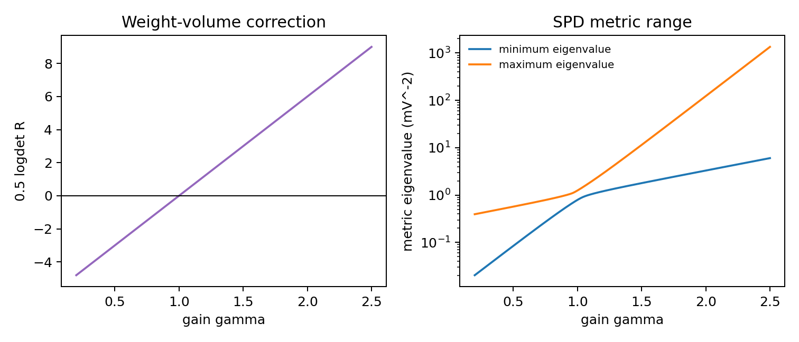

# Multi-channel sensor: metric-volume correction

[Examples index](../README.md) ·
[Repository overview](../../README.md) ·
[Technical details](TECHNICAL_DETAILS.md)

This synthetic example isolates detcorr's metric-volume correction. It recovers
the requested target even though the state Jacobian is the identity; omitting
the parameter-dependent metric-volume term shifts the inferred gain by `-0.547`
posterior standard deviations.

Here **graph target** means the posterior obtained after solving the shared-gain
constraint for the channel states.

## Problem

Four latent channel states share a gain:

```math
u_i=\gamma x_i,
\qquad c(\gamma,u)=u-\gamma x.
```

Because state and residual use the same mV coordinates,

```math
D_uc=I,
\qquad \log|\det D_uc|=0.
```

The finite constraint penalty separately uses a parameter-dependent positive
definite metric `R(gamma)`.

## What detcorr changes

The required metric-volume term is

```math
\frac12\log\det R(\gamma).
```

Its range is `13.8` log units across the deliberately wide positive-gain grid.

| Target | Mean `gamma` |
|---|---:|
| Reduced graph | 1.189961 |
| Naive weighted tube | 1.140092 |
| detcorr weighted tube | 1.189961 |



*The metric-corrected tube follows the solved-state target; omitting metric
volume shifts the gain even though the state Jacobian is constant.*

Exact four-state Gaussian integration gives a worst corrected centered
log-density error of `2.36e-4` at the committed finite penalty. All three
posterior modes are interior to the grid, with negligible boundary mass.



*The changing metric determinant tracks the gain-dependent constraint-tube
volume while its eigenvalues remain positive.*

## Why it matters

Parameter-dependent weighting changes the volume of a constraint tube even
when the primary state Jacobian is constant. detcorr accounts for both sources
without conflating an algorithmic metric with observation noise.

## Run

From this directory:

```bash
python -m pip install \
  "detcorr @ git+https://github.com/Olsson-Materials-Modelling/detcorr.git@a414f063515359f70952e2717a506b75e69e4b0b"
python -m pip install -r requirements.txt
python src/sensor_weighted_constraint_demo.py \
  --outputs ../../regenerated/weighted-sensor
python -m pytest -q tests
```

## Scope and next step

This synthetic gain-and-preconditioner validation isolates the metric-volume
contribution. An empirical sensor model can reuse the construction with a
measured calibration likelihood and justified covariance model.

[Machine-readable results](outputs/summary.json)
