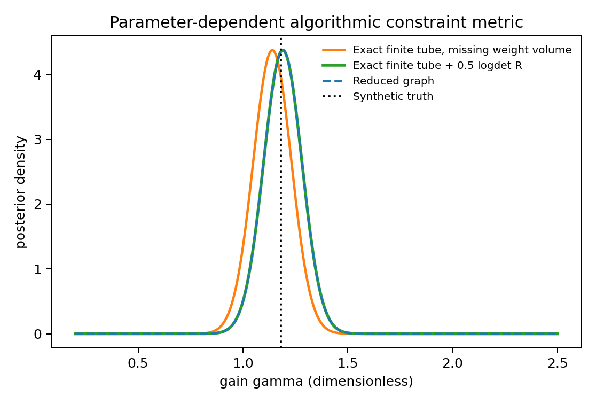
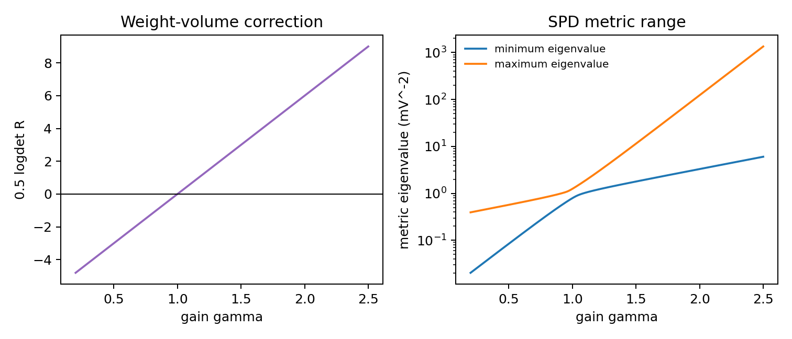

# Technical details: weighted multi-channel sensor constraint

[Back to the example overview](README.md)

This synthetic worked example isolates the secondary determinant correction
created by a parameter-dependent constraint metric. It is a controlled
measure-correction demonstrator, not an empirical sensor calibration.

## Problem

Four latent channel states (u_i), measured in mV, share a dimensionless gain
\(\gamma\):

\[
u_i=\gamma x_i,
\qquad
c(\gamma,u)=u-\gamma x.
\]

The state and residual use the same mV coordinates, so

\[
D_u c=I,
\qquad \log|\det D_uc|=0.
\]

The reduced target is a graph posterior with respect to \(d\gamma\).

Synthetic observations are generated once from `gamma_true = 1.18` and four
declared fixed noise offsets. Their diagonal standard deviations define the
observation likelihood.

Separately, the finite-penalty constraint uses

\[
R(\gamma)=W(\gamma)^\mathsf{T}W(\gamma),
\]

where (W) is a nonsingular numerical channel preconditioner in mV\(^{-1}\).
This is an **algorithmic constraint metric, not observation noise**. Its fixed
triangular mixing and exponential row scalings are declared in the source. The
variation is intentionally strong enough to make a missing volume term visible
in a four-channel CI example.

The log determinant is evaluated relative to a declared one-mV reference
volume per channel. Changing voltage units adds only a gain-independent
constant when the state measure and metric are transformed together.

## Solution and independent check

The weighted finite-penalty target contains

\[
-\frac{\rho}{2}c^\mathsf{T}R(\gamma)c
+\frac12\log\det R(\gamma).
\]

Because both the observation likelihood and constraint penalty are Gaussian in
the latent state, the script integrates over all four (u_i) exactly using the
combined precision matrix. This route is independent of the reduced graph
density. The exact corrected marginal approaches the graph posterior, while
the same integral without \(\tfrac12\log\det R\) retains a visible bias.

The committed run uses `rho = 3e7`. Its corrected finite-penalty marginal has
a worst centered log-density difference of about `2.36e-4` from the hard graph
target, below the strengthened `5e-4` validation limit. At the tenfold coarser
`rho = 3e6` the difference is about `2.36e-3`; the observed tenfold reduction
is the expected leading `O(1/rho)` finite-penalty convergence, rather than a
looser acceptance threshold.



The primary state-Jacobian correction is identically zero. All of the effect in
this example comes from the secondary weight-volume term. For the public API
audit, the residual is passed as a callable and its identity state Jacobian is
recovered by central finite differences rather than supplied as `logdet=0`.



## Run and verify

From this directory, with `detcorr` installed:

```bash
python src/sensor_weighted_constraint_demo.py \
  --outputs ../../regenerated/weighted-sensor
python -m pytest -q tests
```

The public output contract is strict JSON + CSV + PNG only beneath `outputs/`.
`summary.json` records the correction range, posterior shifts,
exact-integration errors, units, synthetic construction and the public
weighted-`detcorr` API audit.

## Interpretation limits

- The data, truth and noise offsets are synthetic and fully declared.
- The metric is a deliberately visible numerical preconditioner; it is not
  inferred from sensor scatter and has no physical covariance interpretation.
- The scalar gain ignores channel-specific calibration, drift and model
  discrepancy.
- Agreement validates measure correction for this finite-dimensional Gaussian
  construction, not a particular sensor technology.

## Prior, likelihood and numerical contract

The graph target is a density with respect to `d gamma`. It uses
`Normal(1.0, 0.35^2)` truncated to the physical support `gamma>0` and
independent Gaussian channel likelihoods with fixed standard deviations
`0.25`, `0.28`, `0.32` and `0.35 mV`. The declared truth is `gamma=1.18`; the
four standardized offsets are fixed in the source.

The numerical grid spans `gamma in [0.2, 2.5]`. All graph, naive and corrected
modes are interior; the smallest endpoint log-density drop is `53.16`, and the
largest probability in either outer two-percent strip is `5.23e-23`. These
checks are emitted to `tables/grid_support_audit.csv`.

The state and residual are in mV. `R(gamma)` is in `mV^-2`, so the committed
`rho=3e7` makes `rho*c^T R c` dimensionless. Log determinants are relative to
one mV of reference state volume per channel. Consistent voltage-unit changes
add only a parameter-independent constant.

The full four-state marginal is evaluated with the exact combined Gaussian
precision. At `rho=3e7`, the corrected centered log-density error is
`2.3618e-4`, below the committed `5e-4` bound. At the tenfold coarser
`rho=3e6`, it is `2.3611e-3`; the ratio `0.10003` supports the expected leading
`O(1/rho)` finite-penalty convergence.

## Reproduction and evidence record

The run is deterministic. Principal evidence is:

- `outputs/summary.json` — strict model, correction, checks and limitations;
- `outputs/tables/posterior_summaries.csv` — graph and finite-tube summaries;
- `outputs/tables/finite_penalty_validation.csv` — exact-integration checks;
- `outputs/tables/algorithmic_metric_audit.csv` — correction and SPD spectrum;
- `outputs/tables/grid_support_audit.csv` — endpoint separation and boundary mass;
- `outputs/sensor_gain_posteriors.png` and
  `outputs/algorithmic_metric_correction.png` — generated figures.
